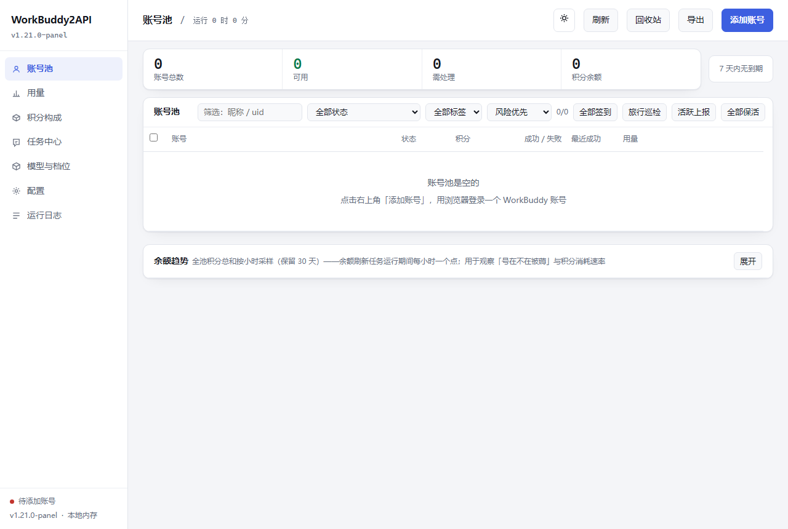
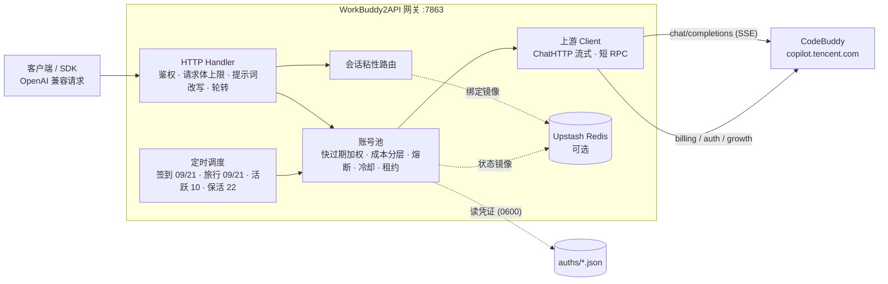

<p align="center">
  
</p>

<h1 align="center">WorkBuddy2API Panel</h1>

<p align="center">
  <a href="README.md">简体中文</a> | <b>English</b>
</p>

<p align="center">
  <b>A multi-account gateway that turns Tencent CodeBuddy accounts into an OpenAI-compatible API — with a Web management panel</b><br>
  Web panel · OAuth browser login · account pool rotation · breaker and cooldown · session stickiness · scheduled check-in / activity / travel / keep-alive · <b>growth tasks one-click (17/18)</b> · recycle bin / tags / balance alerts / scheduled backups · streaming / non-streaming · <b>OpenAI + Anthropic dual protocol</b> (<code>/v1/chat/completions</code> + <code>/v1/messages</code>, the latter including a gateway-executed server-side <code>web_search</code>)
</p>

<p align="center"><b>English overview</b>: beyond the panel features above, the gateway speaks the <b>Anthropic Messages API</b> (<code>/v1/messages</code>) for Claude Code / ZCode, including a gateway-side <code>web_search</code> server tool that returns <code>server_tool_use</code> / <code>web_search_tool_result</code> blocks, and accepts mid-conversation <code>system</code> messages sent inside the <code>messages</code> array. Upstream free-tier queueing (error codes <code>6020</code>/<code>6021</code>) is treated as an upstream-wide condition rather than account rate limiting: rotation fails fast, no account is penalized, and the panel shows a dedicated "upstream queue busy" banner. Since <b>v1.16.0</b>, session-dead accounts are grouped with a one-click re-login flow (reusing the device OAuth flow), mass session-kill events trigger a banner + webhook alert, every RT rotation is audited with out-of-process double-spend detection, the <code>auths/</code> directory is guarded by a cross-host lease lock, scheduled keep-alive tasks are jittered to avoid burst fingerprints, and a smart keep-alive mode only refreshes tokens nearing expiry. Since <b>v1.19.1</b>, tool schemas that use <code>$ref</code>/<code>$defs</code> (the compressed form emitted by MCP clients such as ZCode) are dereferenced and inlined before being sent upstream — the upstream validator flattens tool schemas without resolving <code>$ref</code> and rejects such requests with <code>400 code=11133</code>; measured side-by-side, keeping <code>$ref</code> returns 400 while inlining returns 200, independent of the model. Only local references are resolved, cyclic references are left intact, and a 16-level depth cap prevents unbounded expansion. See <a href="#core-capabilities">Core Capabilities</a> below.</p>

<p align="center">
  
  
  
  
</p>

<p align="center">
  
  <a href="https://github.com/wjf1/workbuddy2api-panel/releases"></a>
</p>

<p align="center">
  
</p>

---

## Table of Contents

- [Usage Disclaimer (Must Read)](#usage-disclaimer-must-read)
- [Project Overview](#project-overview)
- [Core Capabilities](#core-capabilities)
- [Growth Tasks One-Click (17/18)](#growth-tasks-one-click-1718)
- [Differences from Upstream](#differences-from-upstream)
- [Architecture Overview](#architecture-overview)
- [Quick Start](#quick-start)
- [Configuration](#configuration)
- [Core Behavior Semantics](#core-behavior-semantics)
- [Web Management Panel](#web-management-panel)
- [API Endpoints](#api-endpoints)
- [Request-Level Logging](#request-level-logging)
- [Deployment and Operations](#deployment-and-operations)
- [Security and Compliance](#security-and-compliance)
- [FAQ](#faq)
- [Key Assertions ↔ Code Sources](#key-assertions--code-sources)
- [Disclaimer](#disclaimer)
- [License](#license)

---

> **This project is an enhanced fork of [Sliverkiss/workbuddy2api](https://github.com/Sliverkiss/workbuddy2api).**
> The upstream repository has since been deleted; this project **has synced to the last upstream update before deletion** (`ea8b1e5`) and has been maintained and evolved independently ever since.
> On top of upstream we rebuilt the visual operations layer; see [Differences from Upstream](#differences-from-upstream) for an overview. The elegant parts of the upstream design (account pool scheduling, error classification, prompt system) are preserved as-is and described below.

> ⚠️ **This project is strictly for your own accounts (check-in / keep-alive / personal tool access). Bulk distribution of quota via throwaway accounts, repackaging, or paid resale is both unsupported and prohibited.** See [Usage Disclaimer (Must Read)](#usage-disclaimer-must-read).

## Usage Disclaimer (Must Read)

This project (including upstream [Sliverkiss/workbuddy2api](https://github.com/Sliverkiss/workbuddy2api), the same below) was built for exactly one purpose: **to let an individual manage their own CodeBuddy accounts** — automatic check-in, keep-alive, and an OpenAI-compatible entry point for their local tools. It is a free, open-source, personal-use tool provided "as is".

Recently we have seen this project used for the following:

- **Bulk-registering throwaway accounts / buying up accounts, then offering paid APIs, shared pools, top-up services and similar businesses**;
- **Repackaging, bundling with license keys, and reselling**, or disguising paid distribution as "public-benefit servers" or "cheap relays".

We **oppose such behavior in the strongest terms** and state the following:

1. **All commercial / resale activity has nothing to do with this project or its author.** This project does not authorize, support, or participate in any public API resale, account pool rental, or license-key distribution; anyone engaging in such behavior bears all consequences (including but not limited to account bans, terms-of-service violations and legal risk) themselves, with no relation to the author or contributors.
2. **Bulk registration and resale of interface quota violate the target platform's terms of service.** CodeBuddy / Tencent terms prohibit bulk account registration and commercial resale of the interface. The upstream repository has been deleted and is no longer publicly maintained — we cannot determine the exact reason, but this kind of abuse is destroying the environment for all legitimate users; please stop consuming the community's goodwill.
3. **Do not buy any "paid edition", "license-key edition" or "public-benefit relay edition".** This project is and always will be free and open source. Any wrapped, encrypted, or paid-bundled "version" is a third-party tampering, unrelated to this project; such distribution cannot be audited and carries the risk of backdoors that exfiltrate your CodeBuddy credentials (`auths/` stores plaintext accessToken / refreshToken). **What you pay for is not this project — it is the opportunity to hand your account to a stranger.**
4. **An honest note on the open-source license.** This project is released under the MIT license, which permits free use and modification of the source — that is the point of open source and we will not revoke it; but MIT grants freedom at the code level, and **does not grant** the right to promote, sell, or bundle-distribute under this project's name, or to demand support and endorsement from the author. The author provides no support, update commitment, or security guarantee for any third-party distributed version.
5. **The author reserves the right to cut losses.** If abuse continues, the author may stop maintaining, close, or delete the repository at any time without notice. Upstream's today may be this project's tomorrow; please act accordingly.

If your use case is managing your own accounts, you are welcome to use it normally, report issues, and submit PRs.

## Project Overview

WorkBuddy2API is a self-hosted **OpenAI-compatible reverse-proxy gateway** that wraps Tencent CodeBuddy (`copilot.tencent.com`) accounts into a unified `/v1/chat/completions` service.

- The official platform offers no OpenAI-shaped open API; this project obtains account credentials through **OAuth device authorization** (the panel's "Add Account" button or `login.sh`), then handles token refresh, account pool scheduling and traffic governance gateway-side;
- Aimed at **personal multi-account** scenarios: account sharing, automatic failover on a single account's failure, cooldown / breaker to prevent cascading collapse, session stickiness so multi-turn context does not hop between accounts;
- Exposes only an OpenAI-compatible interface to clients, so existing SDKs / frontends / tools work **with zero changes**.

> ⚠️ Compliance note: this is an **unofficial** gateway that uses CodeBuddy accounts as upstream, **restricted to accounts you are authorized to use, tested on your local machine / private environment**. See [Security and Compliance](#security-and-compliance) for the detailed boundary.

> 🛠 **Before changing code, read [`docs/DEV-HANDOFF.md`](docs/DEV-HANDOFF.md)**: current baseline (HEAD / test duration / largest file), prioritized backlog (including where to change / how / risks / acceptance), the testing and commit conventions you must follow, and the pitfalls already hit (concurrent SSE headers, CRLF vs gofmt, panel embed requires a rebuild). Read it and you can start without re-surveying the codebase.

## Core Capabilities

| Capability | Description |
|---|---|
| 🔑 **OAuth one-click login** | `login.sh` device authorization flow, automatically writes credentials to disk and restarts the container to load the new account |
| 🔄 **Multi-account pool** | Expiring-credit weighting + cost tiering + weighted random selection, Top-5 candidates + thundering-herd prevention |
| ⚖️ **Daily limit guardrails (1.17.0)** | Three guardrails: per-account daily token cap / per-account daily credit cap / per-account per-model daily token cap (each with its own switch, auto-released at 0:00 CST, counters persisted with state); a capped account is switched away automatically, and a credit-capped account only accepts free models (free/paid determination follows the same rule as the "credit floor") |
| 🔀 **Model fallback routing (1.17.0)** | `pool.model_fallback`: when a requested model hits a 6004 model-level rate limit, the same account retries with the configured equivalent model (cooldown recorded under the original model, fallback writes no persistent state, the original model is restored when the cooldown expires); if the whole pool has that model cooling down, it degrades first and only then errors |
| 🛡️ **Breaker and cooldown** | 429 soft cooldown from 600s with exponential backoff (capped by `soft_rate_max`), 404 fixed 60s short cooldown, 402 hard cooldown until 04:00 the next day, breaker on consecutive failures, in-flight lease throttling |
| 🚦 **Upstream queue protection (1.15.5)** | Upstream free-tier queueing (business code `6020 queue.waiting` / `6021 queue.full`) is a **server-side queue watermark** unrelated to accounts or models → classified as `ErrUpstreamQueue`: **zero penalty on accounts, rotation fail-fast** (rotation stops at the point of detection), and while the gate is active subsequent requests **return 429 `upstream_queue_busy` without contacting upstream** (no request amplification, no account burn). The duration honors upstream `retry_after` (clamped to 15s–2m) and the gate is released automatically on any successful request; the panel and `/status` expose `upstream_queue` and show an "upstream queue busy" banner |
| 🧲 **Session stickiness** | The same session (`conversation_id`) sticks to the same account where possible, TTL is refreshed on use, binding is dropped on failure, and can be mirrored to Redis to survive restarts |
| ⏰ **Scheduled tasks** | Check-in (09/21, ending with the **streak manager**: redeem unlocked tiers + spend all lottery draws) + activity report (10:00, lights up streak / unlocks adoption + streak self-check) + cat travel (09/21, independently scheduled) + token keep-alive (22:00), four independent switches **Startup catch-up (1.22.0)**: if the process was down across today's slots, one catch-up round runs on restart, with `runstamps.json` deduplication so repeated restarts never re-hit upstream. |
| 🔁 **Session-death recovery (1.16.0)** | Accounts disabled by session death (12153 / bare gateway 401) are automatically classified as "needs re-login" (`dead_kind`), with an inline one-click **re-login** (reuses the device authorization flow, overwrites the same-uid credentials and revives the account); ≥3 accounts judged dead within a 10-minute window → panel banner + webhook alert; sub-healthy accounts show a `session n/3` consecutive-death counter; `probe_dead_hours` optionally probes dead accounts on a schedule and auto-revives them once upstream wrongly revoked state is lifted |
| 🕵️ **RT rotation audit and double-active protection (1.16.0)** | Every token refresh is audited to JSONL by sha256 fingerprint (source / host / PID self-attestation, retained 7 days); after seeding a baseline at startup, any **out-of-process** RT consumption (a deployment copy on another machine / an independent script) triggers a "credential double-active" alert — the most suspicious cause of upstream's chain revocation of entire token chains; the `auths/` directory takes a lease lock (a fresh lease from another host refuses startup by default); scheduled keep-alive tasks are jittered by `hash(uid+date)` (default 20-minute window) to remove the on-the-hour volley fingerprint; `keepalive_mode=smart` refreshes only accounts nearing expiry (RT rolls on a constant 60-day basis, so refreshing everything daily is ≈97% redundant) |
| 🧵 **Automatic truncation continuation (1.22.0)** | When upstream stops at `finish=length`, the same account and model continue and multiple segments are stitched into **one continuous SSE** (still exactly one `[DONE]`, usage merged across segments). Also includes **blind retry on cut streams** (one retry when upstream drops without a terminal frame), **narration rescue** (`stop` + a tail ending in “…:” + a tool session → write the rest), **tool-only rescue** (last message is a tool result but the model only wrote one sentence → adopt tool calls only, discard the prose), and **streaming starved rescue** (thinking ate the whole budget → resend with thinking off). Never continued: an explicit small client limit, truncated tool arguments, or a disconnected client |
| ⚡ **Streaming + non-streaming** | Outbound always forces `stream:true`; SSE frames are rebuilt from a spec whitelist (one unified chunk id per response, one id per response); 15s idle keep-alive emits an SSE comment frame / Anthropic ping event (long reasoning does not drop the connection); non-streaming is aggregated locally into a single response; since 1.24.0 the `stream_options.include_usage` contract is honored (the gateway synthesizes the trailing usage chunk when the upstream omits it, so Codex/SDKs never lose token accounting) |
| 🧠 **Reasoning model compatibility** | DeepSeek chain-of-thought injection (`thinking.type=enabled` + default tier), `reasoning_content` backfill on multi-turn, automatic effort tier downgrade |
| 💬 **System prompt system** | Gateway-owned prompt replaces the client system message (default `custom`), eliminating content false positives whose source is the system prompt; `passthrough` degrades and retries automatically when blocked |
| 🗑️ **Fingerprint sanitization** | Outbound request-body blacklist fingerprint field cleanup (can be disabled), layered on top of the prompt system |
| 🚧 **Inbound guardrails (1.19.0)** | `server.max_body_mb` request body limit (rejected before reading the body, 413 / `request_too_large`, consuming no account selection or upstream quota) and `server.rate_limit_rps` inbound rate limiting (token bucket keyed by **TCP peer**, 429 + `Retry-After`, exempting `/status` and `/healthz`). Both default to `0` = off, zero behavior change |
| 📊 **Observability** | One table log line per request (TTFB / token rate / uid); `/healthz` carries a `service` identity usable by load balancers / host liveness probes; optional diagnostic listener `server.debug_addr` (pprof + low-cardinality `/metrics`, **separate port**, off by default); upstream `requestId` recorded in the same ledger row as the local upstream transaction |
| 🧹 **Outbound slimming (1.19.0)** | `features.strip_tool_metadata`: strips `metaData` (traceId / traceparent / baggage and other pure-observability fields) from tool-call blocks, saving tens of KB of context in long conversations; default `false` = payload byte-identical |
| 🧩 **MCP schema compatibility (1.19.1)** | Dereferences and inlines `$ref`/`$defs` in tools JSON Schema and deletes the definition blocks. Upstream flattens `tools[].function.parameters` without resolving `$ref`, so compressed tool definitions from MCP clients (ZCode etc.) trigger `400 code=11133` across the board; measured side-by-side, keeping `$ref` returns 400 while inlining returns 200, independent of the model. Only local references are resolved (remote `$ref` is not fetched), cyclic references are left intact, there is a 16-level depth cap, and the payload is byte-identical when there is no `$defs` |
| 💊 **Empty-response rescue** | Upstream counts reasoning and content against the **same** `max_tokens` budget, so thinking can eat the whole allowance and produce an empty reply ("content 0 bytes + `finish=length`"; measured: `max_tokens` 100~300 all empty). When the gateway detects "budget exhausted but zero output" it **resends once with thinking disabled at the same allowance**, giving the budget back to the content; it does not inflate the client's allowance, does it at most once per request, and returns the original result on failure. DeepSeek-family models only (upstream does not support disabling thinking for others), non-streaming path only |
| 🛡️ **Guilt-by-association protection** | Upstream judges "abnormal account behavior" (403 / 11140) at the **device and egress** level rather than per account — after a hit, switching accounts only feeds the next one into the same trap (a comparable project measured 7 of 7 accounts banned in a single task). This gateway stops immediately on a hit, and if ≥2 different accounts are restricted within a 15-minute window it **pauses dispatch for the whole pool** (503 + `Retry-After`) instead of testing more accounts; set `upstream.restriction_hold_seconds` to 0 to disable the pool-wide pause |
| 🔒 **Insecure-binding write protection (1.19.3)** | When listening on a non-loopback address (`:7863` / `0.0.0.0`) with an empty `api_key`, write methods (POST/PUT/PATCH/DELETE) always return 405 with `Allow: GET, HEAD, OPTIONS`, while read-only methods pass — so a forgotten key does not let the LAN/Internet freeload accounts via `/v1` or add/remove accounts via `/panel/api`. With an `api_key` set or a loopback listener the guard is fully bypassed, zero behavior change |
| 💾 **State persistence** | Pool state is written atomically to local disk + optionally mirrored asynchronously to Upstash Redis, newest wins on restart |
| ♻️ **Recycle bin and scheduled backups** | "Remove account" soft-deletes into `data/trash/` (retained 30 days by default, restorable / permanently deletable / auto-purged); a daily on-the-hour backup packs `auths/` + pool state into a zip (N rotating copies, **excluding config.json**), with manual backup and download from the panel |
| 📈 **Balance trend and membership tier (1.17.0)** | Account pool "balance trend" box: pool-wide credit total sampled hourly as an SVG curve (30-day window, to see whether accounts are being drained and at what rate); a membership tier pill next to each account nickname (billing summary once a day, failures write no conclusion) |
| 🏷️ **Account tags and alerts** | Multiple tags per account (persisted and round-tripped through export/import) + list filtering by tag / keyword; accounts below the "credit floor" automatically appear in a panel alert banner (same threshold as selection floor, zero upstream requests) |
| 🧠 **OpenAI Responses compatibility (1.20.0)** | `POST /v1/responses`: for clients that only speak the Responses protocol, such as **Codex CLI**. Reuses the main Chat pipeline (a converting ResponseWriter) with no second scheduling logic; `input` accepts strings and message arrays, `instructions`→system, `function_call` history items→`tool_calls`, built-in tools stripped and degraded; the response `output` is ordered reasoning→message→function_call, usage converted to Responses terms, `finish=length` marked `incomplete`; the streamed named-event sequence is complete |
| 🩺 **Three batches of silent-failure fixes (1.21.0)** | Three "no error, but quietly degrading" shapes: ① **transport failures attributed to the egress, not the account** — dial/DNS/TLS failures happen before upstream ever sees the account, and recording them as account consecutive failures dragged healthy accounts into degradation (a comparable project measured 13 accounts degraded by 196 URL errors in 4 hours); they are now recorded against the `direct:<domain>` egress with second-scale backoff (from 1s, capped at 15s, ±25% jitter), and 4 consecutive failures on the same egress fail fast with 503; ② **SSE single-line glued-frame splitting** — upstream occasionally packs two chunks into one `data:` line, breaking the whole client-side parse; the gateway now scans by bytes (tracking escapes and bracket depth) into independent frames, validates each frame's JSON separately, and passes data through untouched when it cannot split; ③ **empty text block padding + 11151 classification + reasoning mirroring** — upstream rejects the entire request over an empty `text` block and cannot self-heal, so a single space is padded in place outbound (padding only the value, never dropping the block), and any that slip through fail fast with 400 without penalizing the account; six model families mirror `reasoning_content` into an empty `reasoning` to keep multi-turn consistency (never creating a field, never filling placeholders) |
| 🪟 **Windows PE version resource (1.21.0)** | `scripts/gen-versioninfo.sh` derives VERSIONINFO (ProductName / FileVersion / CompanyName) from `appVersion` and injects it, executed automatically before build in the CI windows matrix entry. Addresses heuristic false positives by domestic AV engines against "unsigned, no version resource, no product info" bare Go binaries (Huorong `HEUR:VirTool/Obfuscator.a`). The syso uses the platform-qualified name `_windows_amd64`, so linux/darwin cross-compilation is unaffected |
| 🤖 **Anthropic protocol compatibility** | `POST /v1/messages` (+ `POST /v1/messages/count_tokens`): Anthropic-protocol clients such as Claude Code / ZCode connect directly; the streamed SSE event sequence (`message_start` / `content_block_*` / `message_delta` / `message_stop`) and non-streaming are both supported, error bodies are Anthropic-shaped; either `x-api-key` or `Authorization: Bearer` is accepted; inline mid-conversation `system` messages inside `messages` (ZCode / Claude Code shape) are also accepted (since 1.15.2) |
| 🌐 **Server-side web_search (gateway-executed)** | When a client declares a `web_search_*` tool, retrieval is **executed by the gateway on upstream's behalf** (so.com fetch and parse), returning `server_tool_use` / `web_search_tool_result` blocks and supporting multiple retrieval rounds within one turn (`max_uses` budget, default 8; when exhausted the tool is withdrawn with a limit notice); when the content cites no sources a `Sources:` list is appended automatically; fake tool-call text (full-width-pipe DSML markers / `<tool_call>` pseudo-XML) is scrubbed identically on streaming and non-streaming paths so it never leaks into content |
| 🖥️ **Web management panel** | Embedded single-page panel (light/dark themes, Esc closes modals, columns degrade gracefully on narrow screens, WCAG contrast), account operations / cockpit-compatible account import and export / model tier lookup / online config editing (hot-applied) / runtime logs / credit tasks, see [Web Management Panel](#web-management-panel) |

## Growth Tasks One-Click (17/18)

Of the 18 growth tasks in the official "Growth Plan", **17 can be completed purely via API with one click in the panel** — no official client installation, no manual interaction: click "Run all" and progress advances automatically, waits for asynchronous scoring to settle, then **claims rewards automatically**. The remaining task shows operation guidance.

### Task coverage and rewards

| Task | Reward | One-click completion method |
|---|---|---|
| `first_buddy` | +300c +8e | Unlock reporting → accept agreement → adopt the first Buddy |
| `create_canvas` | +300c +5e | Design canvas creation event group (Ardot telemetry) |
| `chat_5` | +100c | Conversation activity reports ×5 (shortfall filled automatically) |
| `Model_chat_GLM5.2` | +100c +5e | One real glm-5.2 conversation (send a short message) |
| `RichMeow_Chat` | +100c +5e +UR Buddy | Desktop conversation event chain (6 events, including success receipts) |
| `Buddy_App` | +100c +5e | Buddy app "discover→enter→authorize" event chain |
| `Buddy_App_QQ` | +50c +5e | Penguin teacher assistant entry event chain (shared with the previous one) |
| `automation_1` | +100c +5e | Scheduled task creation success event |
| `Library_read` | +100c +5e | Library reading click (web-domain report) |
| `template_5` | +100c +5e | Template usage event group ×5 |
| `playbook_prompt` | +100c +5e | Inspiration case "make the same" send event |
| `expert_5` | +100c +5e | Real expert summon+use chain ×5 (expert marketplace fetch real expert → real conversation → use event) |
| `Expert_team_use_3` | +100c +5e | Expert team summon+use chain ×3 |
| `Hp_Appearance` | +100c +5e | Theme setting + skin-take-effect event |
| `Expert_lighthouse` | +100c +5e | Lightweight cloud expert summon+use chain (real conversation requestId, **earns one free month of a lightweight server**) |
| `skill_1` | +100c +5e | Real conversation + skill load event (skill_info) |

**One-click completion of everything on a brand-new account ≈ +1950 credits +78 energy**; only a few tasks involve real conversations (one for `Model_chat_GLM5.2`, several fast-model short conversations each for `expert_5`/`Expert_team_use_3`/`skill_1`), while the rest are behavioral event reports with zero conversation consumption.

### The one that cannot be automated

| Task | Reason |
|---|---|
| `Expert_Philanthropy` | Requires a real donation (the server verifies a donation receipt when claiming; measured to be non-bypassable) |

### How it works (brief)

Task scoring goes through `/v2/report` behavioral reporting, but **different tasks recognize different client fingerprints**: CLI fingerprint (`www.codebuddy.cn`), desktop fingerprint (`copilot.tencent.com` + `WorkBuddy/5.5.6` UA + `workbuddy-desktop` event family), and web fingerprint (`www.workbuddy.cn` + `x-client-platform: web`). The gateway builds the criterion event chain for each task class under the corresponding fingerprint (`internal/upstream/desktop.go`); expert tasks additionally require a real expert id and real conversation receipts (the expert sequence beyond `internal/upstream/streak.go`). A 200 on report ≠ scored — the panel polls task progress after execution and, once the threshold is reached, automatically calls the web-domain claim endpoint.

> ⚠️ Behavioral events are idempotent per day: clicking "Run all" again does not consume resources twice, and tasks already at threshold are skipped automatically.

### 🧭 Task Center (new panel view)

The "Task Center" view consolidates the scattered task capabilities into one place:

- **All-account task scan**: one click pulls growth tasks for every account (19 unfinished and automatable, including the mini-program-specific "campus day" and "mini-program first conversation") plus back-to-school to-dos, in a single list
- **Execution queue**: queues to-dos per account — serial within an account (sharing the mutex with single-task / run-all), optionally concurrent across accounts (1-3); progress updates in real time on each entry
- **Separate back-to-school status card**: per-account status matrix of 5 tasks (share / desktop / conversation ×3 / expert / student verification) plus remaining lottery draws, with one-click triggering of the whole-account closed loop
- **Log channels**: runtime logs filterable by "task / conversation / system" — however heavy the conversation traffic, task results are not drowned out; log entries carry a channel badge and timestamp

<details>
<summary><b>🎒 Back-to-school event (5/5 fully automatic)</b> — event period ended 2026-09-24; reverse-engineering results archived, click to expand</summary>

All 5 tasks of the official "AI good Buddy, back-to-school gifts" mini-program event are **fully automated via pure API** (appended to the check-in schedule, idempotent):

| Task | Reward (daily) | Criterion (reverse-engineered) |
|---|---|---|
| Share the event | +100c +1 draw | Calling `share-complete` directly lights it up |
| Desktop experience (single) | +100c +1 draw | viewed activation + real chat + desktop six-event chain |
| Chat with AI 3 times | +50c +1 draw | 3 `chat_request_send` telemetry hits after viewed (no real session needed) |
| Summon the back-to-school expert | +50c +1 draw | mp event chain after viewed (summon ×3 + conversation) |
| Student verification | +100c | Requires real WeChat student verification, not implemented |

All lottery draws are spent automatically. Reverse-engineering results from that period (cf-connect encrypted channel, mp cloud conversation full chain) are recorded in `data/desktop-task-protocol.md` §8.

The same event also has two **mini-program-specific** tasks in the growth task center (`X-Client-Platform: miniprogram` only, invisible in the default list, +100c+5e each):

| Task | Criterion (reverse-engineered) |
|---|---|
| `school_season` campus day | mini `chat_request_send` + `activityId=school_open_day_2026` (not lit without activityId; both accept/claim require the mp header) |
| `Sequential_Tasks_1` mini-program first conversation | mini `chat_request_send` (no activityId; the server correlates by the source=mini_program fingerprint) |

The task center scan automatically merges mp-specific to-dos; accept carries **registration read-back verification** (upstream has a form returning 200+OK without recording it, so an ineffective accept is retried once automatically).

</details>

### Streak redemption and lottery (automatic)

Growth center streak tiers (consecutive login 7/14/28 days) grant credits / energy / make-up cards / **lottery draws** when redeemed, and lottery draws can only be obtained from redemption. The gateway hooks this onto the end of the daily check-in schedule to run the closed loop automatically (see [Scheduled tasks](#scheduled-tasks)): tiers are redeemed the day they unlock, and any draws are spent automatically — no manual watching required.

## Differences from Upstream

Increments in this branch relative to [upstream master](https://github.com/Sliverkiss/workbuddy2api) (all verified in real multi-account environments):

### Added

| Capability | Description |
|---|---|
| **Key group distribution (1.24.0)** | `key_groups` configures multiple independent API keys (`{name, key, models, rpm}`): each group can bind a per-group model allowlist (both chat-by-name and `/v1/models` listing are narrowed) and a group-level RPM limit (single shared bucket per group name; 429 carries the group name and Retry-After); the main `api_key` always stays valid, and panel saves take effect hot |
| **IP/model dual allowlists (1.24.0)** | `models.whitelist` model allowlist (hot-reloadable; non-empty = only listed models are usable, stacked with the Hidden blacklist); `server.allowed_ips` source-IP allowlist (CIDR or exact IPs, requires restart; `/healthz` and `/status` are exempt, loopback is always allowed, invalid entries fail fast at startup) |
| **Batch QR-code onboarding (1.24.0)** | The add-account dialog gains a "batch onboarding" collapsible: fire 1..10 OAuth authorization sessions at once, with a 3s aggregated frontend poll showing waiting/success/failure per row; completed sessions persist and hot-load (reusing the single-account check-in/activation/balance refresh flow) |
| **Web management panel** | `internal/panel`, frontend go:embed-ed as a single file into the binary, zero external dependencies. Account pool visualization (health color bar / credit bar / cooldown countdown), credit expiry distribution (1.23.0: KPI summary cards + custom tooltips + legend solo/multi-select filtering + sort-by-amount and ≤7-day view), per-account operations, batch tasks, log viewing, light/dark themes |
| **Session-death governance (1.16.0)** | Dead-account grouping and one-click re-login (reusing the OAuth device flow), mass-death alerts (single disable hook as the sole funnel + `internal/alert` banner/webhook), RT rotation audit and external double-spend detection (`internal/rotaudit`, fingerprint JSONL + alert on out-of-process consumption), auths lease lock (`internal/authlease`, prevents two instances sharing a directory), scheduled task jitter (removes the volley signature), smart keep-alive (on-demand rotation by ExpiresAt + failure backoff), dead-account probing (auto-revive on wrongful revocation). Design doc `docs/DESIGN-v1.16.0.md` |
| **Recycle bin / tags / alerts / backups (1.14.0)** | "Remove account" soft-deletes into the recycle bin (restore / permanent delete / expiry purge); multiple account tags persisted and round-tripped through cockpit export/import; accounts below the credit floor enter the panel alert banner; daily scheduled backup of auths + pool state as a zip (downloadable, excluding config.json) |
| **Export/import round-trip integrity (1.14.1)** | The cockpit-compatible export format now fills in the `realm` / `device_token` keys: accounts exported with device risk headers and explicit realm annotations import with all fields intact (end-to-end boundary accounts measured and locked; import of the old format is unchanged) |
| **Import format compatibility upgrade (1.14.2)** | The import endpoint natively accepts **nested account files** (`{"account":{...},"auth":{...}}`, i.e. this panel's `auths/` on-disk format), flat single objects and mixed arrays, and supports **whole-zip upload** (auto-extracting inner `*.json`, a bad file only records errors without blocking the rest) and multi-file selection; the "Import JSON" tab shows the first 3 error details |
| **Anthropic protocol compatibility layer (1.15.0 / 1.15.2)** | `POST /v1/messages` + `POST /v1/messages/count_tokens`: Anthropic request → internal OpenAI body → **reuses the existing chatCompletions pipeline** (selection / rotation / timeouts / WAF / accounting, no duplicated scheduling logic) → response translated back into Anthropic shape (SSE frames rewritten one by one); the server-side `web_search` tool has retrieval **executed by the gateway** (so.com fetch and parse) and returns `server_tool_use` / `web_search_tool_result` blocks, multi-round retrieval with a `max_uses` budget, and a source-link fallback in the content; `x-api-key` and Bearer dual credentials (constant-time comparison); fake tool-call text (full-width-pipe DSML markers / `<tool_call>` pseudo-XML) scrubbed identically on streaming and non-streaming; since **1.15.2**, accepts mid-conversation `system` messages inlined in the `messages` array (ZCode / Claude Code shape, passed through in place) |
| **Request metrics and sanitized logs** | The panel shows completion success rate / HTTP success rate / average latency / recent requests, and responses carry `X-Request-Id`; JSONL archives request metadata only, never prompts, response bodies or credentials. The request record table carries the **call origin** (client IP / User-Agent, disableable via `logging.request_client_info`), with filtering by IP / UA / model / account / request ID and result |
| **In-browser OAuth account adding** | The panel's "Add Account" button completes device authorization → writes credentials → **hot-loads into the pool (no restart)**, replacing the `login.sh` command-line flow; the "Import JSON" tab in the same modal supports batch import of cockpit tools accounts (since 1.14.2: nested / single-object / zip, multi-select), while the "Export" button at the top exports cockpit-compatible JSON in reverse (`GET /panel/api/export/cockpit`) |
| **Online config editing (hot-applied)** | Edit `config.json` directly in the panel: API key / `soft_rate` / sanitization switches / pool parameters / task schedules **take effect immediately**; assembly-time fields (listen etc.) prompt for a restart after saving. Writes use deep merge + atomic replacement, preserving unknown keys |
| **Credit task system** | Task list / accept / claim endpoints + panel modal; "Run all" covers **17 tasks** (conversation / adoption / desktop behavior chain / template / inspiration case / canvas / expert summon / skill trial / theme / library / night owl etc.), advancing progress, waiting for asynchronous scoring to settle, then **claiming rewards automatically**, pure API with zero client dependency |
| **Automatic config generation on first run** | When no `config.json` exists in the directory, a recommended config is generated (including a `crypto/rand` random `api_key`) — double-click and go |
| **Sticky session content fallback** | When the client sends no `conversation_id`, a session key is derived from a hash of `system + first user` (`d-` prefix), so generic OpenAI clients also enjoy stickiness |
| **Balance background refresh** | `schedule.balance_refresh_minutes` (default 10) periodically queries balances and updates the pool; cooling accounts are unfrozen automatically when their balance recovers |
| **Model capability exposure** | `/v1/models` includes real upstream fields such as `supported_efforts` / `default_effort` / credit multiplier / input and output limits |
| **Security hardening** | Constant-time key comparison (`internal/httpauth`), CSP and security response headers, UID allowlist preventing path traversal, frontend attribute escaping fix |
| **Adoption prerequisite fix** | Upstream `travelAdopt` lacked the report prerequisite, so adoption always failed with `first_buddy task not completed yet`; after this branch's fix, +300 was measured on 3/3 accounts |

### Upstream sync

**First round (fork baseline `53ee3a1` → `9a87758`, 34 commits)**: four task classes scheduled independently, pool file split, 12153 counting consecutive occurrences before disabling, narrowing of the 429 `code=6004` model-level rate limit, no penalty for 11101, request body 413, DeepSeek chain-of-thought, reasoning_content backfill, Codex fingerprint sanitization, system prompt system, configurable outbound UA, etc.

**Second round (`9a87758` → `ea8b1e5`, 2026-09-14, low-level changes only)**:

| Upstream change | What was absorbed |
|---|---|
| Sanitization enhancements | `tool_calls.arguments` blind-spot fix (tool-call turns with content=null were previously not sanitized at all), bare `11-128` anti-probe rewriting, desktop identity sentence (comma form) leak fix, whole-sentence rewriting of feedback lines |
| Outbound headers | UA aligned to the official three-part form `WorkBuddy/<ver> WorkBuddy/<ver> CLI/<ver>` (defaults 5.5.4/2.137.1, configurable); `X-IDE-*` usage attribution four headers + `X-Agent-Purpose` (`client_name` set to `WorkBuddy` aligns with the official desktop client); `X-Device-Token` device risk header (three sources: auth per account / config / file); `X-IDE-Version` filled in |
| Concurrency fixes | Client IP passed as a request parameter (removing a shared-field race); single-segment UA form for billing |
| Check-in idempotency | `IsAlreadyCheckin` recognizes "already checked in today" (code=10001/14001), so the scheduler no longer logs duplicate check-ins as failures |
| Sticky liveness judged per model | When a session-bound account hits the 6004 model-level limit, a request for another model unbinds and reassigns automatically (fixes "cannot switch accounts after a limit"); `/healthz` probe counts model-exempt forms (fixes "false 503 when all accounts are limited by a single model") |
| Report enhancements | `ReportChatActivity` supports an independent `requestID` (distinguishing multiple report entries within one session) |

Not absorbed (deliberately excluded): the script system (task_runner/school scripts — we already have a more complete pure-API implementation), governance/CI workflow, cost-ledger-based selection (depends on usage.credit observation, benefit unproven).

> The upstream repository has since been deleted; the second round above (`ea8b1e5`) is its **last update before deletion**, fully absorbed by this branch. After that there is no further sync relationship with upstream; this repository is the reference for evolution.

## Architecture Overview



Upstream requests pass through a unified rewrite pipeline before going outbound (`internal/upstream/payload.go`): forced `stream:true`, `developer` role normalization, tool_choice normalization, `image_url` strings made compatible with the OpenAI object form, DeepSeek chain-of-thought injection, `reasoning_effort` tier downgrade, `reasoning_content` backfill, fingerprint sanitization.

## Quick Start

> **Three steps to run (full details in the four deployment methods below)**
>
> ```bash
> # 1. 拉取并启动（镜像免克隆）
> mkdir -p auths data && cp config.example.json config.json
> docker run -d --name workbuddy2api -p 7863:7863 -e TZ=Asia/Shanghai \
>   -v ./auths:/app/auths -v ./data:/app/data -v ./config.json:/app/config.json \
>   ghcr.io/linguo2625469/workbuddy2api-panel:latest
>
> # 2. 健康检查（无可用账号时返回 503 属正常）
> curl -s http://localhost:7863/healthz
>
> # 3. 打开面板，点「添加账号」完成浏览器 OAuth 登录
> #    http://localhost:7863/panel/
> ```
>
> Once accounts are loaded, point any OpenAI client at `http://localhost:7863/v1` (key = your `api_key`).
> Prefer not to use Docker? Download the single-file binary from [Releases](https://github.com/wjf1/workbuddy2api-panel/releases), put `config.json` next to it, and run it.

### Requirements

- **Docker + Docker Compose** (the server deployment method; the image already contains a low-privilege user and all tool scripts) — or
- **Windows / macOS / Linux running the single-file binary directly** (no Docker needed, see "Windows single-file run" below)
- One or more registered CodeBuddy accounts for OAuth login
- Host Go ≥ 1.27 (only needed when building from source, aligned with the go directive in `go.mod`)

### Method 0: GHCR image (no clone, no build)

CI automatically builds multi-architecture images (`amd64` / `arm64`) and publishes them to GHCR — a deployment path that skips `git clone`:

```bash
# 1. 准备配置与数据目录
mkdir -p auths data && cp config.example.json config.json
#    建议编辑 config.json 设置 api_key（或留空由程序自动生成随机密钥）

# 2. 拉取并运行
docker run -d --name workbuddy2api \
  -p 7863:7863 -e TZ=Asia/Shanghai \
  -v ./auths:/app/auths -v ./data:/app/data -v ./config.json:/app/config.json \
  ghcr.io/linguo2625469/workbuddy2api-panel:latest

# 3. 健康检查（无可用账号时返回 503）
curl -s http://localhost:7863/healthz
```

> **After the first publish the package must be made public**: GitHub repository page → Packages → `workbuddy2api-panel` →
> Package settings → Change visibility → Public, otherwise pulling requires `docker login ghcr.io`.
>
> Image tag rules: pushes to the `main` branch publish `latest` / `main` / `sha-xxxxxx`; pushing a `v*` tag additionally publishes
> `1.2.3` / `1.2` / `1` semantic versions; PRs only build for verification and do not push.

### Method 1: Docker Compose (recommended for server deployment)

```bash
# 1. 克隆
git clone https://github.com/linguo2625469/workbuddy2api-panel.git
cd workbuddy2api-panel

# 2. 准备配置（compose 挂载此文件，缺失会导致容器启动失败）
cp config.example.json config.json
#    建议编辑 config.json 设置 api_key（或留空由程序自动生成随机密钥）

# 3. 启动（首次会构建镜像，约 1-2 分钟）
docker compose up -d --build

# 4. 健康检查（无可用账号时返回 503）
curl -s http://localhost:7863/healthz
# {"healthy":0,"total":0,"service":"workbuddy2api"}
```

Once started, open **`http://localhost:7863/panel/`** and log in with the panel's "Add Account" (see the next section).

Common operations:

```bash
docker compose logs -f          # 跟踪日志
docker compose restart          # 重启
docker compose down             # 停止并移除容器（数据在 ./auths 与 ./data，不受影响）
```

### Method 2: Windows single-file run (no Docker)

```powershell
# 1) 下载 Release 中的 wb2api.exe，或从源码构建
bash scripts/gen-versioninfo.sh   # 注入 Windows 版本资源（治杀软误报，CI 同款）
go build -trimpath -ldflags="-s -w" -o wb2api.exe ./cmd/server

# 2) 直接运行：首次启动自动生成 config.json（含随机 api_key，日志打印一次）
.\wb2api.exe -config config.json

# 3) 浏览器打开面板添加账号
#    http://127.0.0.1:7863/panel/
```

The exe is **single-file and self-contained** (frontend assets are embedded in the binary); copy it to any Windows machine and run it, as long as the `auths/` (credentials) and `data/` (state) directories are writable.

### Method 3: Run from source (development and debugging)

```bash
go build ./...
go vet ./...
go test ./...                      # 完整测试套件
go run ./cmd/server -config config.json
```

Build all binaries:

```bash
CGO_ENABLED=0 go build -trimpath -ldflags="-s -w" -o wb2api ./cmd/server
CGO_ENABLED=0 go build -trimpath -ldflags="-s -w" -o signin_bin ./cmd/signin
CGO_ENABLED=0 go build -trimpath -ldflags="-s -w" -o login ./cmd/login
CGO_ENABLED=0 go build -trimpath -ldflags="-s -w" -o credit ./cmd/credit
```

### Adding accounts (login)

**Method A: Web panel (recommended, works on all platforms, no command line)**

Open `http://127.0.0.1:7863/panel/` and click "**Add Account**" in the top right: the panel shows an authorization link → complete the login in the browser → credentials are detected and written automatically → **hot-loaded into the pool (no restart)**, with the first check-in completed along the way.

The "**Import JSON**" tab in the "Add Account" modal supports batch account JSON import, **with multiple file selection or a direct `.zip` upload** (inner `*.json` files are extracted automatically, `__MACOSX` and similar irrelevant files are skipped; a single bad file does not block the rest and each source is reported individually). Three account shapes are supported: **cockpit tools export array** (`uid` / `access_token` / `refresh_token` required), **flat single object**, and **this panel's nested `auths/` on-disk form** (`{"account":{...},"auth":{...}}` — just drop your existing `workbuddy-<uid>.json` file or zip in), with mixed arrays also supported; after import, accounts join the pool and are checked in / activated automatically. The reverse operation: click the "**Export**" button at the top to open the export modal, **select the accounts to export (single / multiple / all)**, and export them as cockpit-compatible JSON (`GET /panel/api/export/cockpit`; the backend also supports `?uids=a,b` for direct filtering). The result can be fed back into cockpit tools' WorkBuddy account library, or re-imported into this panel for migration / backup.

**Method B: Command-line script (Linux / macOS only, requires bash + python3)**

```bash
./login.sh
# 按提示在浏览器打开授权链接 → 回到终端确认 → 凭证落盘 auths/workbuddy-<uid>.json
```

`login.sh` bundles authorization URL retrieval + browser login + token polling + first check-in + credential write + container restart, with no PKCE throughout (state is issued by the server). The account pool aligns itself with the `auths/` directory at container startup, so a new credential file is discovered automatically.

> Windows users should use Method A (or WSL); `login.sh` requires python3.

### Verification

```bash
# 模型列表
curl -s http://localhost:7863/v1/models -H "Authorization: Bearer your-api-key"

# 账号状态（汇总 + 每账号详情，disabled 账号透出 disabled_reason）
curl -s http://localhost:7863/status -H "Authorization: Bearer your-api-key"

# 流式聊天
curl -sN http://localhost:7863/v1/chat/completions \
  -H "Authorization: Bearer your-api-key" \
  -H "Content-Type: application/json" \
  -d '{"model":"deepseek-v4-flash","messages":[{"role":"user","content":"hi"}],"stream":true}'

# 非流式聊天（本地聚合）
curl -s http://localhost:7863/v1/chat/completions \
  -H "Authorization: Bearer your-api-key" \
  -H "Content-Type: application/json" \
  -d '{"model":"deepseek-v4-flash","messages":[{"role":"user","content":"hi"}],"stream":false}'
```

### Connecting Anthropic-protocol clients (Claude Code / ZCode)

The gateway also implements the Anthropic Messages API (`POST /v1/messages`); Anthropic-protocol clients just point their base URL at this gateway and use the gateway `api_key` as the key:

```bash
# 非流式：x-api-key 与 Authorization: Bearer 两种凭证都认
curl -s http://localhost:7863/v1/messages \
  -H "x-api-key: your-api-key" \
  -H "content-type: application/json" \
  -d '{"model":"cn:deepseek-v4.1-flash","max_tokens":1024,"messages":[{"role":"user","content":"hi"}]}'

# 服务端 web_search：客户端声明 web_search 工具，检索由网关执行，
# 结果以 server_tool_use / web_search_tool_result 块回吐，正文附来源链接
curl -sN http://localhost:7863/v1/messages \
  -H "x-api-key: your-api-key" \
  -H "content-type: application/json" \
  -d '{"model":"cn:deepseek-v4.1-flash","max_tokens":2048,"stream":true,"system":"You are an assistant for performing a web search tool use.","messages":[{"role":"user","content":"搜索：等保测评 一密一用 密钥管理"}],"tools":[{"type":"web_search_20260209","name":"web_search","max_uses":8}]}'
```

- **Claude Code**: `ANTHROPIC_BASE_URL=http://127.0.0.1:7863`, `ANTHROPIC_AUTH_TOKEN=<api_key>` (or `ANTHROPIC_API_KEY`).
- **ZCode**: choose the Anthropic protocol as the provider, set the base URL to `http://127.0.0.1:7863`, and the key to `api_key`.
- Model names are the ids from `/v1/models` (e.g. `cn:glm-5.2`, `cn:deepseek-v4-flash`); `count_tokens` is an estimate without a tokenizer (request JSON byte count / 3), used only for the client's approximate context management.
- **Mid-conversation `system` messages** (`{"role":"system"}` inside the `messages` array, which ZCode / Claude Code use to carry injected system reminders) have been supported since 1.15.2: they are passed through at their original position in the message stream, not merged or reordered; `content` accepts both strings and text-block arrays.

## Configuration

**`config.example.json` is the most complete reference for configuration**: every field, default value and structure can be found there, and example values are all placeholders like `test_key`, **containing no real secrets**. The table below is a quick reference of field meanings.

### Field reference

| Field | Default | Description |
|---|---|---|
| `listen` | `:7863` | HTTP listen address. `:7863` equals `0.0.0.0:7863` (all interfaces); for local-only use, prefer `127.0.0.1:7863` to reduce exposure |
| `api_key` | empty | Gateway auth key; **empty + loopback listener = no auth, direct pass** (local use). **Empty + non-loopback listener** (`:7863` / `0.0.0.0:7863`) = read-only mode: write methods (POST/PUT/PATCH/DELETE) all return 405, read-only methods pass (since v1.19.3). Must be set for public / LAN deployments |
| `auth_dir` | `./auths` | Account credential directory |
| `state_file` | `./data/state.json` | Account pool state persistence file |
| `server.read_timeout` | `300s` | Total inbound request read (including body upload) time limit; large contexts / file blocks forwarded through a reverse proxy time out with 400 `read body: i/o timeout`; `0` = unlimited; change requires restart (#100) |
| `server.max_body_mb` | `0` | Inbound request body size limit (MB). `0` = unlimited (default, consistent with historical behavior); when positive, oversized requests are rejected before reading the body with 413 (the Anthropic endpoint returns `request_too_large`), consuming no account selection or upstream quota |
| `server.rate_limit_rps` | `0` | Inbound rate limit (requests/second, token bucket keyed by **TCP peer host**). `0` = unlimited (default). Applies only to `/v1/chat/completions`, `/v1/models`, `/v1/messages`, `/v1/messages/count_tokens`, **excluding `/status` and `/healthz`** (rate-limiting monitoring / liveness probes would be misread as an outage). Over-limit returns 429 + `Retry-After` (Anthropic side: `rate_limit_error`). Pairs with `max_body_mb`: one governs how large a single request is, the other how fast a single client goes |
| `server.rate_limit_burst` | `0` | Token bucket capacity (allowed instantaneous burst). `0` = uses `ceil(rps)`, at least 1 |
| `server.debug_addr` | `""` | Optional diagnostic listener (pprof + `/metrics`), empty = not started. A **separate port** rather than mounted on the main mux: pprof has no auth and `profile` can export CPU/heap samples, with heaps containing request bodies and account tokens. Bind to loopback only, e.g. `"127.0.0.1:7864"` |
| `panel.package_detail_limit` | `5` | Number of earliest-expiring packages shown by default per account on the credit composition page; the remaining unused packages and used-up packages are collapsed into aggregates |
| `logging.request_archive_enabled` | `true` | Request metadata JSONL archiving switch; prompts, response bodies and Authorization are never recorded |
| `logging.request_retention_days` | `7` | Request archive retention days; expired files are removed at startup and during periodic cleanup |
| `logging.request_archive_max_mb` | `100` | Total request archive capacity limit (MiB); oldest files are deleted first when exceeded |
| `logging.request_client_info` | `true` | Whether request logs record the **call origin** (client IP + User-Agent): written to the JSONL archive, the stdout log line and the panel's "Runtime logs". The IP is taken from the first segment of `X-Forwarded-For` / `X-Real-IP`, falling back to the TCP peer when no proxy headers exist; the UA is truncated to 200 bytes. When disabled, origin fields are left empty (IP is personal data; turn off on shared deployments). **Hot-applied** |
| `logging.admin_audit_path` | empty | **Admin operation audit** log path (JSONL append). Empty = disabled. Records admin write operations such as manually re-running schedules with action/target/status code/source IP/key fingerprint (first 4 bytes of sha256, **never plaintext**). Write failures are only logged and do not affect business logic. Requires restart |
| `upstream.restriction_hold_seconds` | `1800` | **Pool-wide pause duration for 11140 risk-control guilt by association**. Upstream judges "abnormal account behavior" at the device and egress level rather than per account, so switching accounts only feeds the next one in. If ≥2 **different** accounts are restricted within the window (15 minutes), dispatch is paused for the whole pool, and requests during that period return 503 + `Retry-After`. Explicitly setting `0` = disables the pool-wide pause (still keeping "stop on hit, do not switch accounts"). Requires restart |
| `cooldown.soft_rate` | `600s` | Soft rate limit (429 / rate-limit text) cooldown base; consecutive triggers on the same account use 2× exponential backoff |
| `cooldown.soft_rate_max` | `2h` | Soft cooldown exponential backoff cap |
| `schedule.checkin_hours` | `[9, 21]` | Daily on-the-hour check-in in local time + balance query unfreeze. Empty array / `null` = not configured, falls back to default (not disabled) |
| `schedule.travel_hours` | `[9, 21]` | Daily on-the-hour cat travel state machine advancement in local time (adopt / depart / claim) |
| `schedule.activity_hours` | `[10]` | Daily on-the-hour conversation activity report in local time (lights up streak + unlocks `first_buddy`) |
| `schedule.keepalive_hours` | `[22]` | Daily on-the-hour token refresh keep-alive in local time |
| `schedule.blackcat_hours` | `[23]` | Daily on-the-hour night-owl top-up in local time (23:00–08:00 counting window) |
| `schedule.checkin_enabled` | `true` | Check-in master switch; `false` truly disables it |
| `schedule.travel_enabled` | `true` | Cat travel master switch (independent of check-in) |
| `schedule.activity_enabled` | `true` | Activity report master switch |
| `schedule.keepalive_enabled` | `true` | Token keep-alive master switch |
| `schedule.blackcat_enabled` | `true` | Night-owl master switch |
| `schedule.include_disabled_in_tasks` | `false` | Lets the four **account-maintenance** tasks (check-in / activity report / token keep-alive / balance refresh) also run for **disabled** accounts — "disabled" only turns off selection, not maintenance. `false` (default) keeps "disabled accounts are skipped" |
| `pool.model_fallback` | empty | Model fallback routing table (1.17.0): `{"requested model": "equivalent model"}`, retrying the same account with an equivalent model on a 6004 model-level rate limit; hot-applied |
| `pool.daily_token_limit` / `pool.daily_credit_limit` / `pool.model_daily_token_limit` | `0` | The three daily limit guardrails (1.17.0, each with its own switch): per-account daily tokens / per-account daily credits (only free models once capped) / per-account per-model daily tokens; auto-released at 0:00 CST; hot-applied |
| `schedule.jitter_minutes` | `20` | Time jitter window for scheduled maintenance tasks (minutes, 1.16.0): each account is spread across `[0, N)` by `hash(uid+date)`, removing the on-the-hour volley risk-control signature; `0` = off. **Hot-applied**; manual buttons are unaffected |
| `schedule.keepalive_mode` | `smart` | Token keep-alive mode (1.16.0): `daily` forces a full refresh every day (the previous semantics); `smart` refreshes only accounts whose `ExpiresAt` is within `smart_keepalive_days` (the RT rolls on a constant 60-day basis, recommended for production). **Hot-applied** |
| `schedule.smart_keepalive_days` | `14` | Smart keep-alive threshold (days); the manual "keep-alive all" is unaffected |
| `schedule.probe_dead_hours` | `[]` | Dead-account probing hours (1.16.0, CST hours; empty = off by default): refresh-probes accounts disabled as "needs re-login", auto-reviving them plus a webhook once upstream's wrongful revocation is lifted. Requires the balance refresh loop to drive it; probe requests themselves are visible upstream, so weigh the trade-off |
| `notify.webhook_url` | empty | Webhook for mass-death / external rotation / dead-account revival events (1.16.0, generic JSON POST, works with Feishu / Bark / WeCom); empty = panel banner only, nothing sent out. **Hot-applied** |
| `notify.mass_kill_accounts` / `mass_kill_window_minutes` / `cooldown_minutes` | `3` / `10` / `30` | Death alert threshold / window / webhook cooldown (minutes) |
| `auths.strict_lease` | `true` | auths directory lease lock (1.16.0): when a fresh lease from another host is detected, `true` refuses startup (preventing RT double-spend chain revocation), `false` degrades to WARN and proceeds; a stale lease on the same host only WARNs (protecting the scheduled-task restart path). Change requires restart |
| `upstream.timeout_seconds` | `120` | Total time limit for short RPCs (refresh / check-in / balance / model list) |
| `upstream.header_timeout_seconds` | falls back to `timeout_seconds` | Limit before the first chat byte (response headers) |
| `upstream.idle_timeout_seconds` | `300` | Idle limit within a chat stream (activity extends it, silence breaks the stream) |
| `upstream.user_agent` | empty | Outbound User-Agent override (empty = current `CLI/2.63.2 CodeBuddy/2.63.2`). The official site's "usage client" column is attributed server-side by outbound UA; the official WorkBuddy desktop UA is `WorkBuddy/<version>`, configure it when needed |
| `features.sanitize_blacklist_fingerprints` | `true` | Outbound request-body blacklist fingerprint sanitization |
| `features.strip_tool_metadata` | `false` | Strips `metaData` from tool-call blocks outbound (about 20 pure-observability fields such as traceId / traceparent / baggage / rawResponse / timestamps). Default `false` = pass through as-is, the outbound payload being byte-identical to historical behavior; when enabled, each history message carrying tool calls can save tens of KB of context (measured: 39 tool-calls ≈ 55–70KB). Only `tool.metaData` / `result.metaData` are removed; `id`/`name`/`args`/`result.text` and `reasoning` blocks are untouched. **Before enabling, capture a real outbound payload with `upstream.dump_dir` for an A/B test** to confirm upstream does not rely on these fields for trace correlation |
| `models.hidden` | `[]` | Model blacklist: models not exposed externally. A bare name = hidden in both realms; `"cn:xxx"`/`"global:xxx"` = hidden only in that realm. Filters the `GET /v1/models` list + rejects named requests in `POST /v1/chat/completions` (400 `model_unavailable`). Hot-applied after saving in the panel |
| `models.aliases` | `[]` | Model mapping: entries are `"client name=real model name"`. A bare key applies to both realms; with a `cn:`/`global:` prefix it applies only in that realm (case-insensitive); the value may carry a prefix to point across realms (`my-glm=global:glm-5.2`). On a hit, the outbound body's `model` is rewritten to the real name and the response echoes the client's original name; the target is still subject to `models.hidden`. Hot-applied after saving in the panel |
| `prompt.mode` | `custom` | System prompt mode: `custom` = the gateway replaces the client system with its own prompt; `append` = insert the gateway prompt after the leading consecutive system/developer blocks (existing messages untouched verbatim); `passthrough` = pass through the client's original system (degraded retries still switch to the neutral prompt) |
| `prompt.file` | empty | Prompt file path; empty = built-in default (about 2KB); a non-empty but unreadable path → startup error |
| `upstash.url` / `upstash.token` | empty | Empty = pure in-memory mode (Noop degradation, functionality unaffected) |
| `pool.max_in_flight` | `3` | Maximum in-flight requests per account (`0` = unlimited) |
| `pool.max_in_flight_global` | `2` | Per-account in-flight limit in the global realm (international WAF risk control is stricter, so concurrency is lowered) |
| `pool.degrade_threshold` | `5` | Consecutive-failure degradation threshold: N consecutive unknown errors (ErrClient/transport) temporarily remove the account from the pool |
| `pool.degrade_cooldown` / `pool.degrade_cooldown_max` | `10m` / `2h` | Degradation duration and cap clamp |
| `pool.cost_explore_interval` | `30m` | costTier conditional exploration window: when the free tier monopolizes and unknown accounts exist, each window piggybacks one real request onto an unknown account (zero added upstream requests; success graduates it, failure follows the existing error policy). `0` = disabled |
| `pool.credit_floor` | `150` | **Credit floor**: when an account's balance is below this value it no longer participates in selection for **measured-paid** models (tier 2, ledger observation valid within 6h) — preventing paid models from draining the balance and cooling even free models until the next day's check-in (worst case ≈11.5 hours unavailable). tier 0 (measured free) / tier 1 (no observation) are **not restricted**: the floor exists to "keep balance for free models", and blocking tier 1 would deadlock bottomed-out accounts whose ledger has expired / been cleared on restart in a state where they "cannot learn again". Includes the session stickiness path (a sticky account at the floor is unbound and switched). When the whole pool is at the floor and all are tier 2, selection returns empty (the gateway returns 503) and **does not let them through**. Check-in recovery crossing the floor restores the account immediately. `0` = off |
| `pool.breaker_threshold` | `3` | Consecutive failures triggering the breaker |
| `pool.breaker_cooldown` | `30m` | Breaker base backoff duration |
| `pool.breaker_cooldown_max` | `6h` | Breaker exponential backoff cap |
| `pool.idle_weight_per_hour` | `0.5` | Idle compensation: +0.5 weight per unused hour |
| `pool.idle_weight_max` | `5.0` | Idle compensation weight cap |
| `pool.prefer_expiring` | `true` | Expiring-credit weighting: accounts that still have valid soon-expiring batches within the window get a ×3 selection weight (virtual instances); it does not sort by expiry time and is independent of batch amount; it is a soft preference, weaker than session stickiness and model cost tiering (#101) |
| `pool.expiring_soon` | `168h` | Soon-expiring weighting window: only accounts that still have valid batches within the window hit the ×3 above; a wider window means more matching accounts and a diluted preference; empty or `0` disables it |
| `session_sticky.enabled` | `true` | Session stickiness routing switch |
| `session_sticky.ttl` | `30m` | Session binding TTL (refreshed on use) |
| `session_sticky.gc_interval` | `5m` | Expired binding GC interval |
| `trash.retention_days` | `30` | Recycle bin retention days: how long the credential file of a panel "remove account" stays in `data/trash/` before automatic cleanup; `0` = keep forever (manual clear only). **Hot-applied** |
| `backup.enabled` | `true` | Daily scheduled backup switch: packs `auths/*.json` + `state.json` into a zip under `data/backups/` (**deliberately excluding config.json**, which contains the plaintext api_key) |
| `backup.hour` | `3` | Local hour (0-23) triggering the daily backup; invalid values fall back to 3. **Hot-applied** |
| `backup.keep` | `7` | Number of backups retained (oldest deleted when exceeded); `0` = no rotation. **Hot-applied** |
| `search.enabled` | `true` | Server-side `web_search` tool master switch (`/v1/messages` only): when a client declares `web_search_*`, retrieval is **executed by the gateway**; when `false`, the tool is silently ignored and the model answers normally (capability degradation rather than an error) |
| `search.max_results` | `5` | Maximum number of results returned per retrieval (clamped to 1..10, out-of-range values silently clamped) |
| `search.timeout_seconds` | `10` | Per-retrieval timeout (clamped to 1..60); on timeout a "retrieval failed" receipt is returned (`web_search_tool_result_error`) without blocking the whole turn |

### Upstream timeout semantics (each of the three segments serves its own purpose)

| Field | Applies to | Default | Behavior |
|---|---|---|---|
| `timeout_seconds` | Short RPCs (token refresh / check-in / balance / model list) | `120` | Hard total duration limit; on expiry the error follows account switching / breaker logic |
| `header_timeout_seconds` | Chat SSE **before the first byte** | `120` | Constrained by `Transport.ResponseHeaderTimeout`; timeout = switch account and resend |
| `idle_timeout_seconds` | Chat SSE **mid-stream idle** | `300` | Active data emission extends the lease and is not cut; only silence times out and breaks the stream to release the lease |

Chat streams (`stream` true or false alike) have **no total duration limit**: chat uses a dedicated client with `Timeout=0`, so long reasoning / long output is never cut off.

### Environment variable overrides

Load order: JSON file → `WB2A_*` environment variables (a variable overrides only when non-empty):

`WB2A_LISTEN` · `WB2A_API_KEY` · `WB2A_AUTH_DIR` · `WB2A_STATE_FILE` · `WB2A_MAX_BODY_MB` · `WB2A_SOFT_RATE`(duration) · `WB2A_SOFT_RATE_MAX`(duration) · `WB2A_TIMEOUT_SECONDS` · `WB2A_HEADER_TIMEOUT_SECONDS` · `WB2A_IDLE_TIMEOUT_SECONDS` · `WB2A_USER_AGENT` · `WB2A_SANITIZE_FINGERPRINTS`(bool) · `WB2A_PROMPT_MODE` · `WB2A_PROMPT_FILE`

## Core Behavior Semantics

### System prompt system

Clients (Claude Code / Codex and other CLIs) inject fixed template sentences into the system prompt, and upstream content moderation **matches them verbatim**, false-flagging legitimate traffic (HTTP 400 + moderation text). The gateway provides two layers of protection that do not replace each other:

1. **Prompt system** (addresses false positives from the **system / developer source**): controlled by `prompt.mode`
2. **Fingerprint sanitization** (catches fingerprint strings in **user / assistant messages**): controlled by `features.sanitize_blacklist_fingerprints`

| Mode | Semantics |
|---|---|
| `custom` (default) | Before going outbound, **replaces** the client system / developer messages with the gateway's own prompt (delete all system / developer messages, insert a single system at the head); user / assistant / tool messages are untouched verbatim |
| `append` | **Inserts** a gateway system message after the leading consecutive system / developer blocks, leaving existing messages (including client project conventions / tool conventions) untouched verbatim — both are used together; during degradation it falls back to replace (retrying with the original fingerprint text would only deterministically hit 400 again) |
| `passthrough` | Passes through the client's original system, with no rewriting |

The built-in default prompt is about 2KB (`internal/prompt/defaultprompt.md`, embedded into the binary). `prompt.file` pointing to a custom prompt file (custom persona / character) replaces the built-in default entirely; **empty = built-in default**; a non-empty but unreadable path → **startup error** (fail fast, never silently falling back to the built-in default).

### Content-blocking false positives and degraded retries

When a `passthrough`-mode request is blocked by upstream content policy (HTTP 400 + `blocked by security policy` / `unapproved channel` / `illegal api invocation` text), it is judged a system-fingerprint false positive: **within the same request** the gateway retries once with the Degraded neutral prompt; if it is still blocked the second time (the user content itself triggered moderation) → the existing error path returns to the client and reports honestly to the caller.

- After a degradation is triggered it persists until it resets at **00:00 CST the next day** (Asia/Shanghai); during degradation, `passthrough` requests go straight to the neutral prompt instead of hitting 400 first
- The degraded state is **in-process memory** and is cleared on restart
- A content problem is not an account problem: `ErrContentBlocked` penalizes no account (no cooldown / breaker / error count), and is absorbed by the gateway's degraded retry

### Error classification and account handling

Upstream errors are classified uniformly by `Classify` (priority order: model not found → balance exhausted → session invalid / account-level fault → account credit exhausted → upstream queueing → rate-limit status code fallback), with account handling as follows:

| Classification | Trigger condition | Account handling | Recovery |
|---|---|---|---|
| Insufficient balance | HTTP 402 / body contains balance keywords | Hard cooldown until **04:00 the next day** (local timezone) | Balance recovery at check-in (09/21) unfreezes automatically |
| Rate limiting | HTTP 429 / rate-limit text (any status code) | Soft cooldown `soft_rate` (from 600s, exponential backoff on consecutive triggers, capped by `soft_rate_max`). **When `code 6004` (model-level) carries "will reset at …"**, cool until the upstream reset wall clock and exempt model switching (see [FAQ](#429-code6004-model-level-rate-limiting-cooldown-semantics)) | Auto-recovery on expiry / backoff cleared on success |
| Upstream queueing | HTTP 429 + code `6020`/`6021` (`queue.waiting` / `queue.full`, or the corresponding text) | **No account penalty** (a server-side queue watermark, unrelated to account or model); **rotation fail-fast** and during the gate returns `429 upstream_queue_busy` directly without sending upstream requests | Gate expiry (honoring upstream `retry_after`, clamped to 15s–2m) or **any successful request** releases it immediately |
| Session invalid | Body contains `Offline user session not found` / `12153` | Permanently disabled only after **3 consecutive** occurrences (a single 12153 is usually a transient glitch: network / brief disconnect / refresh race); refresh success / any success / manual revival clears the count | Manual re-login (`login.sh`) or `ReviveDisabled` revival |
| Upstream 404 | HTTP 404 | Soft cooldown fixed at 60s (not following `soft_rate`, no separate backoff) | Auto-recovery on expiry |
| Server error | HTTP ≥500 | Feeds the consecutive-failure count, breaker on threshold | Breaker expiry / cleared on success |
| Request body parse failure | HTTP 400 + `Unmarshal chat params failed` / code `11101` | **No account penalty, and no rotation** (malformed client JSON; switching accounts still yields 400) — passes the original text through immediately as **400** | Immediate |
| Model parameter rejected | HTTP 400 + code `11133` / `model_param_invalid` (`extError.code=400001`) | **No account penalty, and no rotation** (request parameters do not satisfy the model; switching accounts is still rejected) — passes the original text through immediately as **400**, avoiding long-backoff client retries on a request bound to fail | Immediate |
| Content blocked | HTTP 400 + moderation text | **No account penalty**; `passthrough` mode goes through degraded retry | Immediate |
| Client error | Other 4xx / business `code≠0` | No penalty, switch account and retry | Immediate |

Request body parse failures (`11101`), model parameter rejections (`11133`) and content blocks alike **penalize no account and do not rotate**: the problem is the request content rather than account health, switching accounts yields the same rejection, and rotation only burns healthy accounts' quota while pushing a final 503 back to the client (which then judges it retryable and retries with a long backoff, appearing as a long hang). Such requests always fail fast, passing upstream's original text back as 400. The gateway does not truncate or pre-block request bodies; every `11101` is malformed JSON sent by the client.

**Breaker**: all cooldown entry points and 5xx share a single consecutive-failure counter `fails`; reaching `breaker_threshold` (default 3) triggers the breaker with backoff `breaker_cooldown × 2^retryCount`, capped at `6h`; success clears it.

**Soft cooldown exponential backoff** (a second escalation line coexisting with the breaker): the soft rate limit's **cooldown duration** itself also backs off by consecutive count — `soft_rate × 2^(consecutive count-1)` on the same account, capped by `soft_rate_max`. The counter `soft_streak` is independent of the breaker's `fails`, is only cleared on **success** or **check-in unfreeze**, and is persisted with `state.json`.

### Account selection strategy

1. Filter: disabled / cooling / broken / in-flight-saturated accounts do not participate
2. Tier by measured model cost, keeping only the currently optimal tier
3. Soon-expiring credit weighting is on by default (a soft preference, not a reordering):

   - Within the model's optimal cost tier, accounts that still have valid soon-expiring batches within the `expiring_soon` window get a ×3 selection weight (`expiringVirtualSlots` virtual instance expansion, same rule on the session stickiness path).
   - No sorting by expiry time and no dependence on batch amount: 14 days out vs 3 days out, 1 credit vs thousands of credits, are treated identically as long as they are within the window.
   - This preference is weaker than session stickiness (a healthy bound account is used directly) and model cost tiering (hard filtering by measured cost); expired, zero-balance, or no-valid-expiry accounts do not enter the weighted set.
4. Weighted random within the same candidate pool (soon-expiring hits get ×3 on top of the above):

   `weight = credits ratio ×10 + idleWeight`

   - `credits ratio` = the account's credits / the maximum credits in the candidate set
   - `idleWeight` = `min(idle hours × idle_weight_per_hour, idle_weight_max)`, with never-used accounts getting the full value
5. Thundering-herd prevention: skip accounts selected within the last 100ms; when everything is cooling, pick the earliest-expiring among non-disabled, non-balance-exhausted soft-cooling / breaker accounts to fill in

### Session stickiness

Reuse the same account for the same session where possible, so multi-turn conversations do not hop:

- Session key extraction order: `metadata.conversation_id` → `metadata.conversationId` → `metadata.user_id` → top-level `conversation_id` → top-level `conversationId` (snake_case takes priority over camelCase)
- TTL refreshed on use (default 30m), GC interval 5m; bindings can be mirrored to Redis (7-day TTL) to survive restarts
- Bindings are dropped automatically on request failure; on success the binding follows the account that finally succeeded

### Scheduled tasks

The five task classes are scheduled independently, each with its own switch, without affecting each other. Container timezone is controlled by `TZ` (compose default `Asia/Shanghai`).

| Task | Switch (default true) | Time (default) | Behavior |
|---|---|---|---|
| Check-in | `schedule.checkin_enabled` | `checkin_hours` `[9, 21]` on the hour | Check-in + balance query; cooling accounts are unfrozen when the balance recovers. **The streak manager is appended at the end** (see below) |
| Activity report | `schedule.activity_enabled` | `activity_hours` `[10]` on the hour | Conversation activity report (`chat_request_send` event, must include `userId`); lights up streak + unlocks `first_buddy`; once per account per day |
| Cat travel | `schedule.travel_enabled` | `travel_hours` `[9, 21]` on the hour | Independently scheduled: adopt when no cat / depart on `idle` / claim on `arrived` |
| Keep-alive | `schedule.keepalive_enabled` | `keepalive_hours` `[22]` on the hour | Token refresh for all accounts; a session invalid is auto-disabled only after **3 consecutive** occurrences |
| Night owl | `schedule.blackcat_enabled` | `blackcat_hours` `[23]` on the hour | **Checks task progress first, then decides**: only when `black_cat` is not yet at threshold does it top up short glm-5.2 conversations within the 23:00–08:00 counting window (once per day accumulating 3 days; a missed run is made up in the next day's window) |

#### Disabled accounts and maintenance tasks (`schedule.include_disabled_in_tasks`)

Default `false`: disabled accounts are skipped by the four tasks above — **check-in / activity report / keep-alive / balance refresh** — consistent with selection filtering.

The panel's "disable" means "**no longer participates in selection**", but these four task classes previously skipped disabled accounts as well — so disabled accounts earned no check-in credits, did not refresh tokens, and had no balance refresh; and since `ReenableIfCredits` explicitly does not revive disabled accounts, even check-in, the only automatic recovery path, was cut, leaving only manual "Unfreeze".

If you use a rotation pattern of "**unlock one account at a time and use disable as a traffic switch**" (fearing risk control with many accounts on one IP), the idle standby accounts are precisely the ones that need check-in most — set it to `true` and disabled accounts will still check in / keep alive / refresh balances, **but still not participate in selection** (the disabled filter on the `pool` selection side is unaffected by this switch).

> This switch **only covers these four scheduler task classes**. Cat travel, night owl, the streak manager (`RunStreakBonusNow`, appended to check-in) and the growth task queue **still skip disabled accounts as before** — if you need those too, please open a separate request.

#### Pause selection (account-level `paused`, no configuration needed)

A more commonly used account-level entry point than the global switch above: the "**Pause selection**" button on the panel's account row. A paused account:

- **Exits selection** (including the all-cooling fallback), shows "selection paused", and returns to the pool immediately on "Resume selection" — without clearing cooldown domains or requiring unfreeze or re-login;
- **Keeps its account maintained unconditionally**: check-in / activity report / keep-alive / balance refresh all keep running (independent of `include_disabled_in_tasks`);
- **The rest of the task system runs as usual**: cat travel (pure RPC: status/depart/claim), the streak manager, the growth task queue and task center scan/execute all still participate — these go through report/claim endpoints and send no model conversations (a few individual task actions carry one real short conversation, such as `Model_chat_GLM5.2`, with limited impact); failures are logged as error lines as usual with no special handling;
- **The only thing skipped is the night owl**: `RunNightChats` sends real glm-5.2 conversations one by one, the only "entire task is model conversation" case in the task system, which directly conflicts with "step aside to avoid risk control".

This is exactly the granularity the "unlock one account at a time, the rest step aside" rotation usage wants: the stepping-aside accounts no longer take **selection traffic**, and also avoid the nightly conversation top-up; all other maintenance actions continue as usual. Difference from "disable": disable is a terminal state (session/authorization judged dead, requires manual unfreeze, maintenance stops by default), while pause is a temporary operations state (the account is healthy, restorable at any time). State is persisted (the `paused` field in state.json) and survives restarts; `disable`/`revive` clear `paused` as well.

#### Streak manager (run automatically at the end of the check-in schedule)

Growth center streak tiers (consecutive login 7/14/28 days) grant credits / energy / make-up cards / **lottery draws** when redeemed, and lottery draws can only be obtained from redemption. After the daily check-in, the manager runs the closed loop automatically (idempotent, silently skipping when not unlocked):

1. Query streak tier status → automatically **redeem** unlocked tiers (not locked / not claimed)
2. Query lottery draws → **spend all draws automatically**, logging prizes (`streak-bonus <uid>: 🎲 …`)

No configuration needed; it follows the check-in schedule; on the day the threshold is reached it completes "redeem → draw" automatically with no manual watching.

**Disabling scheduled tasks**: use `schedule.*_enabled: false` to disable explicitly (with all four set to `false` the scheduler does not spin idle but blocks waiting for the exit signal). Note two semantic points:

- **An empty array and `null` mean "not configured → fall back to default"**, not "disabled"; to truly disable, use `*_enabled: false`
- **Disabling does not erase the hour configuration**: `*_hours` is preserved as-is, and switching back to `true` restores the original times; hour values must be 0-23, and invalid values error at startup
- Turning off check-in also turns off "unfreeze on balance recovery", so hard-cooled accounts can only wait for the natural expiry at 04:00 the next day

#### Activity report (independently scheduled)

For every available account in the pool, at `activity_hours` (default `[10]` on the hour) send one conversation activity report (event `chat_request_send`, body is an array, the event must include `userId`):

- One report lights up the growth streak + unlocks the `first_buddy` task (adoption prerequisite) simultaneously
- Once per account per day is enough (single time point): daily activity rewards are deduplicated by day, and repeat reports yield no extra benefit
- `conversationId` is generated by the gateway (`wb2api-<ms>`), no real session needed
- Rate limiting: 800ms between accounts (same rule as travel)
- **Streak self-check**: after a successful report, read back the streak days (read-only oracle), with one greppable log line per account: `activity <uid>: streak days=N`. `days=0` is logged as **warn** (`report OK but streak.days=0 (silent drop?)`, corresponding to upstream "200 but silently dropped"); a read-back failure is logged as warn but does not affect the main flow (reports are idempotent per day, not retried, observation only)
- For manual diagnostics / catch-up runs use `python3 scripts/probe_active.py` (read-only probing; write operations default to dry-run and need `--yes`)

#### Cat travel (independently scheduled)

For every available account in the pool, at `travel_hours` (default `[9, 21]` on the hour) advance one leg, performing exactly one action per leg without polling or waiting. Two legs form the default loop: at 9:00 claim yesterday's arrival reward and depart, at 21:00 claim today's arrival reward (`daily_limit_reached` automatically blocks a second departure).

| Probe result | Action |
|---|---|
| No cat (`buddy` is `null`) | Accept the agreement first (idempotent), then attempt adoption; crossing the threshold grants +300 credits and the cat |
| `state=idle` and not departed today | Depart with `location_id=4` (ancient town inn; all 4 locations have identical reward / duration ranges, no optimum) |
| `state=arrived` | Claim the arrival reward (with `record_id`) |
| `state=traveling` / daily limit reached / unknown state | Skip |

- When the adoption threshold is not met, upstream returns HTTP 400; attempted only once per account per calendar day (retried across days, the record kept in memory only); the threshold can be lifted by activity reports
- Rate limiting: 800ms between accounts
- One departure per calendar day: reset by CST (Asia/Shanghai) calendar day, independent of the container `TZ`
- Failure isolation: a single account's failure skips only that account for that leg; 401 does not force a refresh (token refresh is left to keep-alive times)

#### Balance background refresh

**Balance background refresh** (`schedule.balance_refresh_enabled`, on by default): every `balance_refresh_minutes` (default 10) minutes, concurrently query all account balances and update pool credits — credits stay fresh between check-in times, and cooling accounts whose balance recovers are unfrozen automatically (same semantics as check-in, but without checking in or refreshing tokens). The panel's "Refresh now" button also refreshes all balances; the 5-second automatic polling is read-only in memory and does not hit upstream.

## Web Management Panel

An embedded management panel (`internal/panel`, frontend go:embed-ed as a single file into the binary, no external build dependencies). Once the service is running, open:

```
http://127.0.0.1:7863/panel/
```

Authentication follows the same rule as the API: when `api_key` is non-empty the panel asks for the key once (remembered in browser localStorage); when empty it is directly usable.
The UI supports **light/dark theme switching** (follows the system preference initially, the button toggles between the two states and remembers the choice), and the left navigation has four views:

| View | Function |
|---|---|
| **Account pool** | KPI overview row (total accounts / available / needs attention / credit balance) + expiry-risk chip (opens a credit expiry drawer) + account table: status badges (shape + text + color triple encoding: available / cooling / selection paused / needs re-login / upstream-banned / disabled), credit bar, success and failure counts, usage summary, inline primary action + ⋯ menu (refresh balance / growth tasks / manage tags / pause selection / disable account / move to recycle bin, dangerous items last); six-state filtering (including "needs attention") + four-level sorting, checkbox batch (concurrency 2), 8-second undo on removal, row detail drawer; balance trend collapsed after the table by default. Narrow screens switch to card mode (status / credits / last success in the card, 44×44 touch targets), with global operations collected into an "all actions" menu |
| **Add account** (top button) | Completes OAuth device authorization in the browser (shows the authorization link + polls automatically); after login the credentials are written and **hot-loaded into the pool without a restart** |
| **Credit tasks** (the "Tasks" button in an account row) | Shows all tasks (progress / reward credits and energy / status); "Accept all" batch sign-up; "Run all" covers **17 tasks** (advance progress + wait for asynchronous scoring + **claim rewards automatically**, idempotent and repeatable); the remaining tasks show operation guidance |
| **Models and tiers** | Real-time upstream query: per-model credit multiplier, default thinking tier, supported tiers (including "off (closable)"), context length and max output; when probe data exists, the max output column shows the **measured limit with a clamping warning** (see "Probing real model output limits"). The list supports **conditional queries**: keyword (ID / name / description / vendor, space-separated AND), realm (CN / Global), capability (tools / vision / thinking / default), thinking tier, price (discount / limited-time free / on sale), and sorting by multiplier, context, max output and ID (the table body is height-capped and scrolls, with the header pinned to the container top) |
| **Usage** | Metric cards (requests / total tokens / input tokens / output tokens / failures / average latency) + token time series chart (gradient bars, mean line, peak annotations; hover shows "time range · input + output = total · request count") + usage detail (switch by account / model / realm) + credit deduction history. **Time range** supports today / last 24 hours / last 3 days / last 7 days / last 30 days / all history / **custom range** (to the minute), with cards, tables and charts all computed over the same window |
| **Configuration** | Online editing of config.json: API key, scheduled tasks (the four task classes' times and switches, balance refresh interval), account pool and traffic governance parameters, upstream timeouts and UA, prompt mode, sanitization/stickiness switches, log origin recording switch |
| **Runtime logs** | **Request record table** (time / result / model / account / **source IP** / **User-Agent** / latency / tokens / credits / request ID), with keyword and result filtering, row count, and **time range** queries such as today / last 24 hours / last 7 days / **custom range** (fetched by time on the archive side, not filtered from already-pulled entries) + the last 500 lines of service log (split into task / conversation / system channels, with toggleable auto-scroll) |

**Config hot-apply**: after saving, `api_key`, `cooldown.soft_rate`, `features.sanitize_blacklist_fingerprints`,
`models.hidden`, `models.aliases`, `logging.request_client_info`, `pool.*` (breaker/in-flight/weights) and `schedule.*` (times/switches/balance refresh interval) **take effect immediately without a restart**;
fields tied to process assembly time (`listen`, `auth_dir`, `state_file`, `upstream.*`, `upstash.*`, `session_sticky.ttl`)
prompt "restart the process to take effect" after saving. Config writes use "deep merge and atomic replacement": only keys covered by the panel form are updated,
while user-written unknown keys and all other fields are preserved as-is.

The top "Refresh" button = query the real balances upstream in full and write them back (the 5-second automatic polling is read-only in memory and does not hit upstream).

The panel backend endpoints are mounted at `/panel/api/*` (same Bearer auth) and can be called from scripts; account operations all land on the pool's existing entry points (`Revive`/`Disable`/`Remove` etc.), consistent with `/status` observation.

**Security response headers**: the panel page and all `/panel/api/*` responses uniformly carry `Content-Security-Policy` (`default-src 'none'`, scripts same-origin only, `frame-ancestors 'none'` to forbid framing), `X-Content-Type-Options: nosniff`, `X-Frame-Options: DENY`, `Referrer-Policy: no-referrer` and others; the frontend script is a separate same-origin `app.js` with no inline scripts or inline event handlers.

**Auth implementation**: `internal/httpauth` unifies Bearer verification for the server and the panel, using a SHA-256 digest + `subtle.ConstantTimeCompare` constant-time comparison (avoiding byte-by-byte comparison leaking key information); the `uid` returned by upstream is validated against an allowlist (`[A-Za-z0-9_-]`, length ≤64) before being used to build credential filenames, preventing path traversal.

> ⚠️ Public deployment note: the service itself only provides plain HTTP, **so you must put it behind an HTTPS reverse proxy** (Nginx/Caddy etc.) and configure access rate limiting; for local or private-network use only, it can be run directly.

## API Endpoints

| Endpoint | Auth | Description |
|---|---|---|
| `POST /v1/chat/completions` | Bearer (when `api_key` is non-empty) | OpenAI-compatible completion; streaming/non-streaming; request body unlimited by default, returning 413 when over the limit if `server.max_body_mb` > 0 |
| `POST /v1/responses` | Bearer (when `api_key` is non-empty) | **OpenAI Responses API compatibility layer** (streaming / non-streaming): for clients such as Codex CLI that only speak Responses. `input` accepts strings and message arrays; supports custom function tools (built-in `web_search_preview` / `file_search` / `code_interpreter` stripped and degraded); `finish=length` returns `status: incomplete`; `previous_response_id` is ignored (the gateway is stateless) |
| `POST /v1/messages` | `x-api-key` or Bearer (when `api_key` is non-empty) | **Anthropic Messages API compatibility layer** (streaming / non-streaming): supports server-side `web_search_*` tools (retrieval executed by the gateway), client-defined tool results (`stop_reason: tool_use`) and image blocks; error bodies are Anthropic-shaped (`{"type":"error","error":{...}}`) |
| `POST /v1/messages/count_tokens` | `x-api-key` or Bearer (when `api_key` is non-empty) | Token count **estimate** (no tokenizer; request JSON byte count / 3) |
| `GET /v1/models` | Bearer (when `api_key` is non-empty) | Model list (purely dynamic fetch, cached 10min; on failure an empty list + 5min negative cache); each model carries `context_length`/`max_output_tokens` (four-level lookup chain: upstream catalog → built-in knowledge table → model.json cache → models.dev), `reasoning_supported_efforts`/`reasoning_default_effort` thinking tiers and descriptions/labels/multipliers and other full fields (when upstream returns them) |
| `GET /admin/tasks` | Bearer (when `api_key` is non-empty) | Lists the schedulable tasks that can be manually re-run and their current run state |
| `POST /admin/tasks/{name}/run` | Bearer (when `api_key` is non-empty) | **Manually re-run a schedule**: `checkin` / `activity` / `keepalive` / `travel` / `blackcat` / `streak`. Returns 202 immediately and runs in the background; concurrent triggers of the same task return 409; an unknown task returns 404 and lists known tasks |
| `GET /status` | Bearer (when `api_key` is non-empty) | Account status summary + per-account details (credits/cooldown/breaker/in-flight/stickiness) |
| `GET /healthz` | None | Health check: returns 200 when there are healthy accounts not saturated, otherwise 503; the response carries an identity marker (see below) |

> Auth rule: verification happens only when `api_key` is non-empty — OpenAI endpoints accept `Authorization: Bearer <api_key>`, and Anthropic endpoints (`/v1/messages*`) additionally accept `x-api-key: <api_key>` (both use constant-time comparison); **when `api_key` is empty those endpoints pass requests through directly**; `/healthz` never requires auth.

`/healthz` response example (200 / 503 share the structure, with only the status code and counts changing):

```json
{"healthy": 2, "total": 3, "service": "workbuddy2api", "realm_servable": {"cn": true, "global": false}}
```

The response also carries an `X-Service: workbuddy2api` header. These two identity markers distinguish **this gateway** from other services that may linger on the same port — the other party returns no such field / header even on a 2xx, so host probes avoid "false success". `realm_servable` states whether each of the `cn` / `global` realms is currently servable (used for per-realm alerting in dual-realm deployments; it does not affect the 200/503 liveness semantics above).

**Host health probe guidance**: strong validation (recommended) uses `/status` + `api_key` — only this gateway holding the correct `api_key` returns 200, while other services return 401 / 404; weak validation (for load balancers that should not hold the key) uses `/healthz` + the `service` field as criterion (`/healthz` never requires auth, and only `service == "workbuddy2api"` counts as hitting this gateway). The container's built-in `HEALTHCHECK` uses the weak validation (in-process only, which is enough).

### Streaming behavior details

- Outbound requests force `stream:true`; SSE frames are **rebuilt from an OpenAI-spec whitelist** (`reasoning_content` preserved, tool calls merged by index, unknown fields stripped)
- Exactly one `data: [DONE]` is guaranteed (written as a fallback when upstream omits it); an empty stream writes one `error` frame first and then `[DONE]`
- Non-streaming requests are aggregated locally from the full SSE stream into a single `chat.completion` response (including `reasoning_content` / `tool_calls`)

### Upstream endpoints

The upstream interfaces are all **undocumented / reverse-engineered** interfaces used by CodeBuddy's official CLI / plugins, with no public API documentation; paths and hosts follow the constants in code (see the source table at the end). Two base hosts:

- **`copilot.tencent.com`**: chat completions (SSE), token refresh, OAuth, model list, growth realm (travel / streak)
- **`www.codebuddy.cn`**: daily check-in, balance query, activity report

| Relative path (absolute paths in the source table) | Method | Purpose |
|---|---|---|
| `chat/completions` | POST | Chat completions (SSE) |
| `console/enterprises/personal/models` | GET | Dynamic model list |
| `plugin/auth/token/refresh` | POST | Token refresh |
| `billing/meter/daily-checkin` | POST | Daily check-in |
| `billing/meter/get-user-resource` | POST | Balance query |
| `report` | POST | Conversation activity report (`chat_request_send` event array, must include `userId`; lights up streak / unlocks adoption) |
| `plugin/auth/state?platform=CLI` | POST | OAuth authorization URL retrieval |
| `plugin/auth/token?state=` | GET | OAuth token polling |
| `plugin/login/account?state=` | GET | OAuth account info retrieval |
| `activity/growth/buddy/agreement` | POST | Cat travel: accept agreement (idempotent) |
| `activity/growth/buddy/first` | POST | Cat travel: first adoption |
| `activity/growth/buddy/info` | GET | Cat travel: cat profile query |
| `activity/growth/buddy/travel/status` | GET | Cat travel: travel status |
| `activity/growth/buddy/travel/depart` | POST | Cat travel: depart |
| `activity/growth/buddy/travel/claim` | POST | Cat travel: claim reward |
| `activity/growth/streak` | GET | Streak days + redeemable tier status (activity self-check / streak manager) |
| `activity/growth/redeem` | POST | Streak tier redemption (`{tier, client_token}`; 403 when not unlocked) |
| `activity/growth/lottery/summary` | GET | Lottery draw count query |
| `activity/growth/lottery/draw` | POST | Draw once (`{client_token}`, consumes 1 draw) |
| `activity/growth/tasks` | GET | Task list (including reward_credit/reward_energy/progress) |
| `activity/growth/tasks/accept` | POST | Accept tasks (`{"task_codes":[...]}`) |
| `activity/growth/tasks/<task_code>/claim` | POST | **Claim task reward** (task code in the path, no body; **web realm `www.workbuddy.cn`**, not the CLI realm — this is the key to successful claiming) |

Outbound requests uniformly carry the `CLI/2.63.2 CodeBuddy/2.63.2` UA (overridable via `upstream.user_agent`); chat requests carry account headers (`X-User-Id` etc.) and **never carry `X-Refresh-Token`** (that header appears only in token refresh requests). Claim requests additionally carry `x-client-platform: web` and the workbuddy.cn Origin/Referer.

## Request-Level Logging

Each `/v1/chat/completions` request outputs one table log line (stdout) when it finishes:

```text
| #001 | 18:31:31 | deepseek-v4 | stream | 200 | uid=0851ce35 | TTFB=801ms | tok=60 | 23.5tok/s | total=2.6s |
```

| Field | Description |
|---|---|
| `#001` | Process-level request sequence number |
| `18:31:31` | End time |
| `deepseek-v4` | Model name (truncated over 11 characters) |
| `stream` / `sync` | Request mode |
| `200` | Status code |
| `uid=0851ce35` | First 8 characters of the account UID |
| `TTFB` | Streaming first-frame latency (`-` for non-streaming) |
| `tok` / `tok/s` / `total` | Output token count / rate / total duration |

**Sensitivity**: logs contain no plaintext tokens (see [Security and Compliance](#security-and-compliance)) and no log file is written to disk.

## Deployment and Operations

### Docker image

A multi-stage image (`golang:1.27-alpine` build → `alpine:3.20` run) compiles all four binaries in one pass and ships them with the image:

- **wb2api** (main service), **signin_bin**, **login**, **credit** + scripts (`login.sh` / `signin.sh` / `credit.sh` / `scripts/probe_active.py`)
- Runs as the `app` user (uid 10001), with `app/auths` and `app/data` pre-created
- The image places `config.example.json` as an empty config (containing no secrets); production mounts a volume over `/app/config.json`
- Built-in `HEALTHCHECK` (`wget /healthz`, 30s interval)

Accounts / data are persisted through `docker-compose.yml` volume mounts: `./auths`, `./data`, `./config.json`.

### Self-check (doctor, 1.22.0)

Run the self-check first when troubleshooting. It reports config loading, the listen/auth
combination, the account pool, token expiry, the data directory, state files and the schedule in
one pass, ending with a single-line JSON blob:

```bash
# Read-only: never refreshes tokens, never triggers tasks — safe against production
./wb2api-doctor -config ./config.json
./wb2api-doctor -config ./config.json -json      # JSON only (for scripts)
./wb2api-doctor -config ./config.json -offline   # skip upstream connectivity probe
```

Exit codes: `0` all green / `1` at least one error-level problem / `2` config failed to load.

### Tool scripts

| Script | Purpose |
|---|---|
| `./login.sh` | OAuth login → write auth → restart container |
| `./signin.sh [auths_dir]` | Batch check-in (refresh first if expired) |
| `./credit.sh` / `./credit.sh -json` | Credit daily report (pretty / raw JSON) |
| `python3 scripts/probe_active.py` | Activity report manual diagnostics / catch-up (probe=read-only / report=single account report / unlock=single account adopt / ALL=whole pool; write operations default to dry-run and need `--yes`) |
| `python3 scripts/probe_max_tokens.py` | Probes each model's **real output limit** (distinguishing silent clamping from the model ending on its own); `--panel-out` results can be displayed directly in the panel (see the next section) |

Binaries are not in git: on first use the scripts automatically `go build` the corresponding `cmd/*` (already precompiled in the Docker image).

### Probing real model output limits

The `max_output_tokens` in upstream `/v3/config` is a **claimed value** and generally inflated: measured, 8 of 16 CN models are
**silently clamped** (requesting a larger `max_tokens` raises no error, the output is truncated at the real limit), with the worst claiming 1M while actually giving 32K.
The "Models and tiers" view therefore supports overlaying **measured annotations** in the max output column:

- 🔴 `32K ⚠ clamped 12×` — measured truncation at 32K, 1/12 of the claimed value (`finish=length` criterion, reliable)
- 🟢 `48K ✓ / 64K ↑` — measured equals claimed / actually larger than claimed
- ⚪ `≥40K` / `?` — full allowance without hitting the ceiling (lower bound) / the model ended on its own so it could not be measured

Measured values are **not hardcoded** — they come from the data file written by the probe tool; after upstream adjusts, rerun once to refresh automatically:

```bash
# 在网关所在机器上（探测会真实消耗积分；单模型预算默认 600s，并行 4）
python3 scripts/probe_max_tokens.py   --base http://127.0.0.1:7863/v1 --key sk-xxx   --panel-out data/output_probes.json

# 断点续测 / 只测指定模型 / 预览计划
... --resume
... --models cn:glm-5.2 --panel-out data/output_probes.json
... --dry-run
```

The file lands in the same directory as the state file (default `data/output_probes.json`; `data/` is gitignored), and the panel's
`GET /panel/api/model_probes` passes it through read-only; once written it **takes effect on the next query, no gateway restart needed**; unprobed
models are unaffected. The design details of the probe criteria (distinguishing the two stop kinds / prompt magnitude matching / parallelism and time budget)
are in the script's header comment.

### Account management

- To add accounts, just copy `auths/workbuddy-<uid>.json`; the pool aligns itself with the directory at startup
- After a session-invalid account is disabled (`disabled_reason` exposed in `/status`), `./login.sh` can re-login and overwrite the credentials; an account already persisted with `disabled=true` can be revived from source side by calling `Pool.ReviveDisabled(uid)` (clears the `disabled` flag in `state.json`)
- Backup = `auths/` (credentials) + `data/state.json` (pool state: credits / cooldowns / counters); with Upstash configured, state is also mirrored to Redis (7-day TTL)

## Security and Compliance

### 1. Credential management (auths)

- **Location**: `./auths` (configurable via `auth_dir`), filenames `workbuddy-<uid>.json`
- **Contents**: plaintext `accessToken` / `refreshToken` + account metadata (`account.uid` / `enterpriseId` / `nickname`)
- **Permissions**: runs as the `app` user in the container (uid 10001); token refreshes are written back atomically by `SaveAtomic` with `0600` (tmp + rename); the first write by `login.sh` follows the login umask, so manually run `chmod 600 auths/*.json` is recommended
- **Never commit to git**: `.gitignore` already excludes `auths/`, `data/`, `backups/`, `config.json`, `*.key`, `*.pem`, `*.env`, `docs/` and all `*.md` working documents except README

### 2. Network exposure and log sensitivity

- Listens on `:7863` by default, with compose exposing `0.0.0.0:7863`, **no built-in TLS**; public deployments must set `api_key`, and a fronting reverse proxy / intranet is recommended
- **Write-protection fallback (since v1.19.3)**: when `listen` is a non-loopback address and `api_key` is empty, non-idempotent methods (POST/PUT/PATCH/DELETE) all return 405 with `Allow: GET, HEAD, OPTIONS` — so even a forgotten key leaves the LAN/Internet unable to consume accounts via `/v1` or add/remove accounts via `/panel/api`. With `api_key` set the guard is fully bypassed; when `listen` is `127.0.0.1` / `localhost` / `::1` nothing changes (local zero-config use as before)
- Request log fields: sequence / model / mode / status code / **first 8 characters of uid** / TTFB / token count — **never** plaintext `accessToken` / `refreshToken` / `api_key` (the `Authorization` header is not read)
- Logs go to **stdout / stderr** (into `docker logs` in a container); the code writes no log files to disk

### 3. Release provenance and compliance boundary

- **No prebuilt release**: the repository has no Release / tag; artifacts = self-built from source (the multi-stage Dockerfile builds locally)
- Login / check-in / credit tools: `./login.sh` / `./signin.sh` / `./credit.sh`
- **No artifact checksums**: `go.sum` only constrains Go module dependencies; Docker images are produced by local `docker compose build` and reference no third-party images
- Upstream CodeBuddy is a commercial Tencent product, and this project is an **unofficial OpenAI-compatible gateway** for it; using its accounts for an API gateway involves the target platform's terms of service and account risk, and the author is not responsible for account bans, terms violations, or usage outcomes

### 4. Authorized use boundary

- Restricted to **accounts you are authorized to use**, tested on your local machine / private environment
- Do not share, resell, or distribute in violation, or use for purposes that violate the target platform's terms; **bulk account registration for API business, repackaging, or bundling with license keys for sale is strictly prohibited** — see [Usage Disclaimer (Must Read)](#usage-disclaimer-must-read) at the top
- Comply with CodeBuddy platform terms of service and local law
- Keep `auths/` (plaintext credentials) and the gateway port well protected

## FAQ

### The panel is full of "429 rate limit" and nearly every account in the pool cools down at the same time — is the account rate limited?

**Most likely it is not an account problem but upstream free-tier queueing** (handling introduced in 1.15.5, from a real case on this machine on 2026-10-15). When the upstream server-side queue backs up it returns `HTTP 429` + business code `6020 queue.waiting` / `6021 queue.full`, with `client_user_type:"free"` in the response — this is an **upstream server-side queue watermark**, unrelated to which account or which model (at the same moment `cn:kimi-k3-1` and `cn:deepseek-v4.1-flash` both return the queue code).

Diagnosis and handling:

- **Check the panel banner**: when `overview.upstream_queue` is active, an "upstream queue busy" banner appears above the account pool (with `queue_position` / `queue_size` / `retry_after`), explicitly stating "unrelated to accounts, not bypassed by switching accounts or models, no manual unfreeze needed". The same-named field in `/status` allows programmatic judgment.
- **Check the error code**: clients receive `429` + `code=upstream_queue_busy` (not the account rate limit's `rate_limit_exceeded`), with `gateway_hint` saying `not an account problem`.
- **Accounts are not penalized**: the queue classification `ErrUpstreamQueue` performs **zero action** on accounts (no cooldown, no breaker, no consecutive-failure feed), and those accounts stay `cooling=false` in the panel.
- **The gateway stops the loss and self-heals automatically**: on hitting the queue it terminates rotation (no more account switching to amplify requests), and during the gate subsequent requests return 429 directly **without sending upstream requests**; the gate duration honors upstream `retry_after` (clamped to 15s–2m), and **any successful request releases it automatically** — no manual intervention is needed once the upstream queue clears.

> Before 1.15.5 this code had no branch and fell into the `status==429` fallback, recorded as account-level rate limiting: in the real case 16 of 17 accounts each took one 429 within 106 seconds and all went into cooldown (600s/1200s/2400s ladder), while the real culprit was merely an upstream queue backlog.

### 429 code=6004 (model-level rate limiting) cooldown semantics

Upstream `429` + `code 6004` means **the usage limit for that model** has been exceeded (the msg usually carries "will reset at YYYY-MM-DD HH:MM:SS UTC+8"), **not that the account as a whole is rate limited**. The gateway handles it as follows:

- **Cool down until the upstream reset time**: when the msg carries "will reset at …", the account's cooldown `until` exactly equals that wall clock (interpreted as UTC+8), capped by `soft_rate_max` (default 2h)
- **Immediately usable by switching models**: a cooldown triggered by 6004 records the triggering model; a request for a **different model** on the same account is treated as servable. Cooldowns for the same model, or with no recorded model, keep the current behavior
- **Fall back to exponential backoff**: if the 6004 has no "will reset at …" text, or for an ordinary non-6004 soft rate limit → it is still `soft_rate` (from 600s, exponential backoff on consecutive triggers, capped by `soft_rate_max`)

### What if a multi-image conversation request body is too large?

The gateway **sets no request body limit by default** (`server.max_body_mb` defaults to `0`): a request body of any size is fully read and forwarded upstream, and oversize-type problems are returned naturally by upstream — whose responses carry more information (you can see upstream's real policy), so the gateway does not pre-block with 413. If deployed publicly and you need a local line of defense, set `server.max_body_mb` to a positive value (e.g. `32`) to enable it: requests over the limit are rejected by `http.MaxBytesReader` before the body is read, returning 413 (the Anthropic endpoint returns `request_too_large`), consuming no account selection or upstream quota. This is a pure opt-in switch; setting it back to `0` restores the original behavior.

**Inbound rate limiting** (`server.rate_limit_rps`) pairs with the size limit above: one governs "how large a single request is", the other "how fast a single client goes". It is likewise `0` = disabled by default. A heuristic starting point: for single-machine personal use start from `5`~`10` (enough for normal conversations and tool calls, while still stopping a runaway script).

Two design trade-offs worth knowing:

1. **The rate-limit dimension is the TCP peer address, not `X-Forwarded-For`**. XFF / X-Real-IP can be constructed arbitrarily by the client, so rate-limiting by them is equivalent to letting an attacker get unlimited quota by forging a different IP per request. The cost: behind a reverse proxy all requests' peers are the proxy address, so rate limiting degrades to a "global RPS cap" — a degradation in the safe direction (it cannot limit a single machine, but it definitely caps the total), and "a runaway script saturating the account pool" is precisely the main incident to prevent.
2. **By IP rather than by `api_key`**: this gateway has only one key anyway, so rate limiting by key is equivalent to global rate limiting and provides no isolation.

- Multi-image / long-context conversations (history images are resent as base64 every turn, with encoding inflating them about 37%) no longer hit a gateway-side 413
- If upstream really returns a 413/oversize error, the gateway passes it through faithfully along the existing error classification chain (no masking, no account penalty — oversize is a request-side problem)
- A half-truncated body caused by a client disconnecting mid-stream reports `400 invalid_request` at the read stage, so truncated JSON is never fed upstream (the issue #41 semantics are preserved on the read-error path)

### Docker deployment reports "failed to write auths/….json.tmp: permission denied" after login?

The container runs as the `app` user (uid 10001), while the host-mounted `./auths` and `./data` directories are not owned by it — so writing the credential tmp file is denied. Three solutions, pick any (the first two **need no root container**):

```bash
# 方案 1（推荐，非 root）：让容器以你自己的 uid 运行——挂载目录本来就是你建的
PUID=$(id -u) PGID=$(id -g) docker compose up -d --force-recreate
# 或写进 .env 文件长期生效（.env 已被 .gitignore 忽略）：
#   echo "PUID=1000" > .env && echo "PGID=1000" >> .env

# 方案 2：把挂载目录属主交给容器默认用户（需要 sudo）
sudo chown -R 10001:10001 ./auths ./data ./config.json

# 方案 3：compose 设 user: "0:0" 以 root 运行（NAS/群晖不便 chown 时用）
```

The error message itself carries this guidance; compose's `user` is parameterized as `${PUID:-10001}:${PGID:-10001}`.

### How do I recover an account after it is disabled?

- **Re-login with `./login.sh`** to overwrite the credentials; it returns to the pool automatically after restart;
- Or call `Pool.ReviveDisabled(uid)` from source side to clear the `disabled` state (`state.json` is refreshed accordingly).

### What if the system prompt is falsely flagged by content policy?

The default `prompt.mode=custom` already replaces the client system with the gateway's own prompt, eliminating most false positives at the source; fingerprint strings in user / assistant messages are cleaned by `features.sanitize_blacklist_fingerprints`, and the two layers stack. In `passthrough` mode, the first block automatically retries the same request once with the Degraded neutral prompt.

### How do I make the official site's "usage client" column show WorkBuddy?

The official site's "usage client" column is attributed server-side by outbound request UA. Configure `upstream.user_agent: "WorkBuddy/2.x.x"` (or the environment variable `WB2A_USER_AGENT`) to rewrite the UA of all outbound requests; the default keeps the current `CLI/2.63.2 CodeBuddy/2.63.2` state (for fingerprint sanitization reasons, configurable rather than hardcoded).

## Key Assertions ↔ Code Sources

| Assertion | Source |
|---|---|
| `prompt.mode` defaults to `custom` | `cmd/server/config.go:148` |
| No gateway-side request body limit by default (`server.max_body_mb` = 0); when positive, `http.MaxBytesReader` wraps the body read and returns 413 | `internal/server/handler.go` chatCompletions body read section · `requestBody()` |
| Outbound forces `stream:true` | `internal/upstream/payload.go:28` |
| DeepSeek chain-of-thought injection (`thinking.type=enabled`) | `internal/upstream/thinking.go:110` |
| Default `reasoning_effort` tier = `high` | `internal/upstream/thinking.go:32` |
| `reasoning_content` backfill on multi-turn (assistant messages) | `internal/upstream/thinking.go:54` |
| Degraded neutral prompt constant | `internal/prompt/prompt.go:25` |
| Degradation trigger and reset at 00:00 CST the next day | `internal/server/degrade.go:30` (Trigger), `:46` (nextMidnightCST) |
| 6004 model-level rate-limit code and reset-time parsing | `internal/upstream/client.go:127`, `internal/upstream/client.go:147` |
| `11101` / Unmarshal failure penalizes no account | `internal/upstream/client.go:114-115`; handling branch `internal/server/handler.go:489` |
| Outbound UA override (empty = current `CLI/2.63.2 CodeBuddy/2.63.2`) | `cmd/server/config.go:73`; wiring `cmd/server/main.go:96` |
| Session-dead consecutive threshold of 3 before disabling | `internal/pool/pool.go:249-253` (`sessionDeadThreshold`) |
| `ReviveDisabled` manual revival | `internal/pool/pool.go:951` |
| Disabled accounts expose `disabled_reason` | `internal/pool/pool.go:1162-1165` |
| Hard cooldown until 04:00 the next day | `internal/pool/pool.go:882` (`CooldownUntilTomorrow4AM`) |
| Soft cooldown backoff capped at 2h | `internal/pool/pool.go:247` (`defaultSoftRateMax`) |
| Top-5 candidate shortlist | `internal/pool/pool.go:584` |
| `activity_hours` defaults to `[10]` | `cmd/server/config.go:135` |
| Activity self-check read-back of streak | `internal/scheduler/scheduler.go:227` (`checkActivityStreak`) |
| Streak endpoint `activity/growth/streak` | `internal/upstream/travel.go:24` (constant), `:139` (`GrowthStreak`) |
| Redis stickiness mirror 7-day TTL | `internal/redisstore/redisstore.go:21` |
| Static model table includes `deepseek-v4-flash` etc. | `internal/server/handler.go:146` |

## Disclaimer

This project is for learning and research purposes only. Users must comply with the CodeBuddy terms of service and bear the risks of use themselves (including account bans, terms violations, etc.). The author is not liable for any direct or indirect loss arising from the use of this project.

## License

This project is released under the [MIT License](LICENSE).

- Free to use, copy, modify, merge, publish, distribute, sublicense, and sell
- When redistributing (in source or binary form), please retain the original repository's MIT copyright and license notices (e.g. note the original source `https://github.com/Sliverkiss/workbuddy2api` in a NOTICE or README)
- This project grants no rights to any upstream (CodeBuddy / Tencent) interface or service; users must still comply with the upstream terms of service themselves
